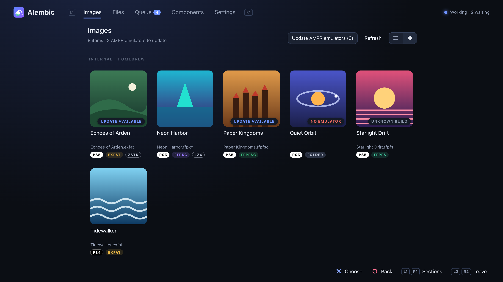
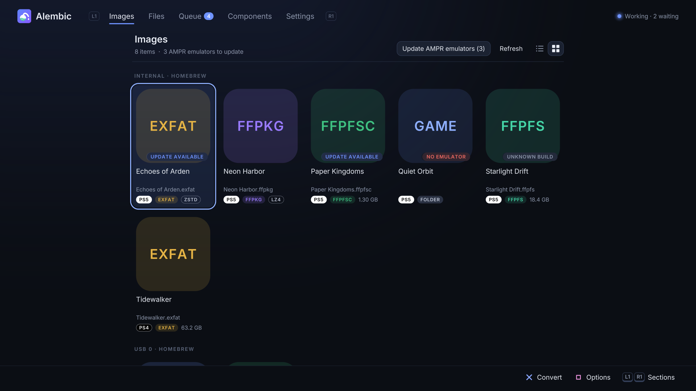
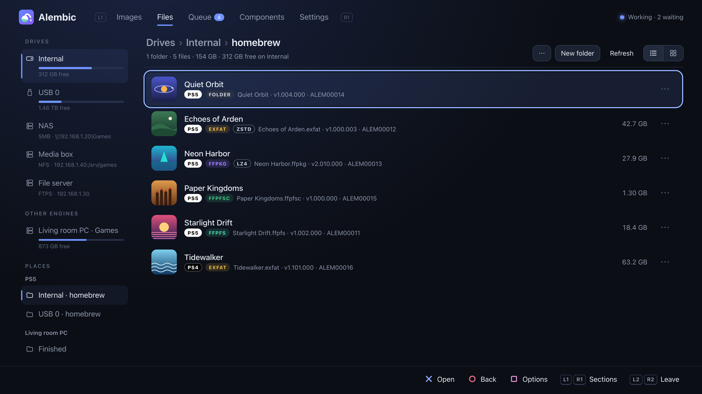
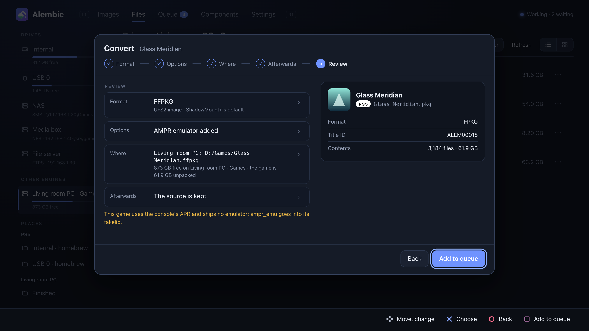
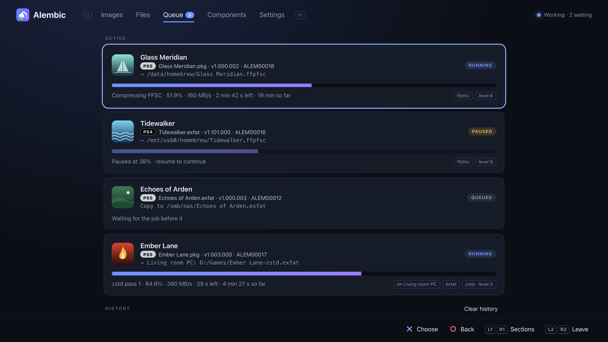
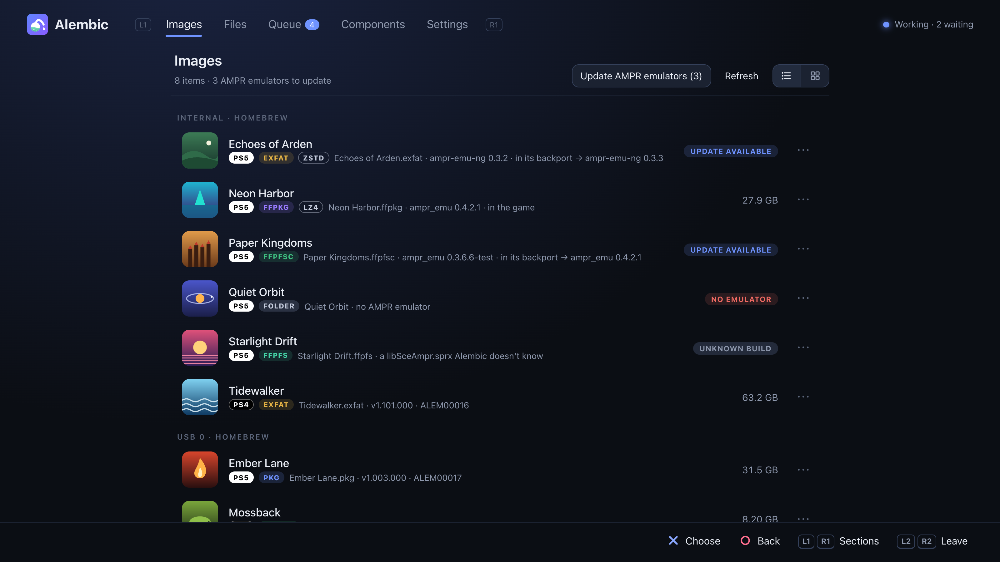
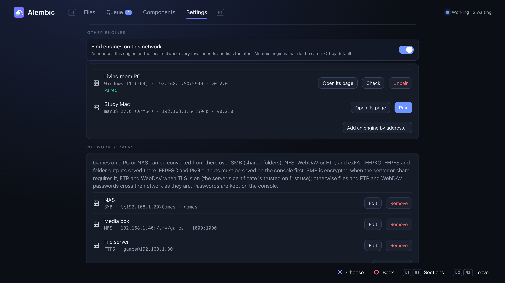

# Alembic

[English](README.md) · [Türkçe](README.tr.md) · [Deutsch](README.de.md) · [Español](README.es.md) · **Français** · [Magyar](README.hu.md) · [Русский](README.ru.md) · [日本語](README.ja.md) · [简体中文](README.zh.md)

*Ceci est une traduction du [README anglais](README.md) ; en cas de différence, c'est la version anglaise qui fait foi.*



Alembic convertit les jeux PS5 et PS4 entre les formats qu'utilisent les
chargeurs homebrew : paquets (FPKG debug PS5, fake PKG PS4), dossiers de dump,
images exFAT, FFPKG (UFS2), FFPFS (PFS) et FFPFSC (PFS compressé). Il tourne
**sur la console**, comme application sur l'écran d'accueil (depuis 0.3.0) ou
comme payload avec une page web, les deux pilotées à la manette, et sur un PC
(Windows, macOS, Linux) comme outil en ligne de commande ou avec le même moteur
et la même page. Les moteurs de votre réseau peuvent s'associer et travailler
ensemble : convertir un paquet qui se trouve sur votre PC, avec le processeur
du PC, directement vers le stockage de la console. Les jeux sur un PC ou un NAS
peuvent aussi être lus et enregistrés via SMB, NFS, WebDAV ou FTP.

> Travail en cours. Gardez une sauvegarde de tout ce que vous convertissez
> tant que vous n'avez pas vérifié le résultat sur votre console.

**Déjà essayé sur une console :** des images FFPFSC faites à partir de dumps
et de paquets se lancent via ShadowMount+ ; les jeux qui ont besoin de
l'émulateur AMPR démarrent une fois celui-ci ajouté ; la console et un PC
s'associent et convertissent l'un pour l'autre ; **Installer** confie un paquet
debug à l'installateur de la console, y compris les paquets qu'Alembic crée à
partir d'un dump (stockés ou Kraken, avec une licence debug générée, donc sans
verrou sur le titre) ; une conversion en pause reprend après une mise à jour du
moteur ; le moteur se met à jour lui-même à partir d'une version publiée (chargé
via Payload Manager) ; l'application console démarre depuis ShadowMount+,
démarre et redémarre le moteur, et pilote une conversion sur un PC associé ; un
paquet converti depuis un partage SMB ; un jeu en paquets zstd (un paquet de
160 Go empaqueté au niveau 5 par un moteur sur PC en un exFAT de 96 Go écrit
sur la console) démarre avec ampr-emu-ng.
Les jeux PS4 convertis depuis leurs paquets démarrent depuis des images via
ShadowMount+ 1.7beta8 (il affiche « Trophy registration failed » pour eux : un
problème de ShadowMount+, [#97](https://github.com/drakmor/ShadowMountPlus/issues/97)).
**Pas encore :** NFS, WebDAV, le chiffrement SMB, FTPS et HTTPS depuis une
console, ainsi que de vrais boîtiers NAS et des partages Windows (tous ont été
vérifiés sur un PC face à Samba, rclone, WsgiDAV et pyftpdlib) ; le lancement
d'un jeu installé depuis un paquet Alembic (l'installation a été essayée, le
lancement non) ; un paquet PS4 créé par Alembic ; les mises à jour PS4 (paquets
de patch) et les DLC. Les paquets de ressources LZ4 fonctionnent pour certains
jeux et pas pour d'autres.

## Ce qu'il fait

| De ↓ / Vers → | Dossier | exFAT | FFPKG (UFS2) | FFPFS (PFS) | FFPFSC | Paquet |
|---|:-:|:-:|:-:|:-:|:-:|:-:|
| Dossier de dump | – | ✓ | ✓ | ✓ | ✓ | ✓ |
| exFAT | ✓ | ✓ | ✓ | ✓ | ✓ | ✓ |
| FFPKG (UFS2) | ✓ | ✓ | ✓ | ✓ | ✓ | ✓ |
| FFPFS (PFS) | ✓ | ✓ | ✓ | ✓ | ✓ | ✓ |
| FFPFSC | ✓ | ✓ | ✓ | ✓ | ✓ | ✓ |
| FPKG PS5 (debug) | ✓ | ✓ | ✓ | ✓ | ✓ | `--rebuild` |
| PKG PS4 (fake) | ✓ | ✓ | ✓ | ✓ | ✓ | `--rebuild` |

Le paquet que devient un jeu dépend du jeu : un jeu PS5 (`sce_sys/param.json`)
devient un FPKG debug PS5, un jeu PS4 (`sce_sys/param.sfo`) un fake PKG PS4.
La page et l'application marquent chaque jeu d'une pastille **PS5** (blanche)
ou **PS4** (noire).

- **Jeux PS4** (depuis 0.3.2) : les fake PKG avec l'habituel code d'accès tout
  à zéro (issus des anciens comme des nouveaux outils d'empaquetage) s'ouvrent
  comme les paquets PS5, sous la forme des fichiers du jeu plus le `sce_sys`
  (`param.sfo`, icônes, trophées, licence) du paquet, et se convertissent vers
  n'importe quelle image. Les images et dossiers d'un jeu PS4 reçoivent le
  `sce_sys/param.json` dont ShadowMount+ a besoin pour le lancer (fait à partir
  de `param.sfo`, comme le fait
  [PS4pkg_to_ffpfsc](https://github.com/SadykovIV/PS4pkg_to_ffpfsc)) ; essayé
  sur une console avec ShadowMount+ 1.7beta8. Un jeu PS4, quel que soit son
  format, se reconvertit en fake PKG PS4, construit comme le fait le
  `pkg_build` de [LibOrbisPkg](https://github.com/maxton/LibOrbisPkg) : la
  licence du jeu est conservée (générée seulement si elle manque), et les
  fichiers PlayGo sont refaits. Un paquet reconstruit à partir de n'importe
  laquelle de ses images est identique, octet pour octet. Les clés viennent de
  LibOrbisPkg (Composants, ou `--ps4-keys FILE` sur un PC). L'émulateur AMPR et
  les paquets LZ4 ne concernent que les jeux PS5. La console à laquelle un jeu
  est destiné se déduit de son ID de titre (`CUSA`, `PPSA`), sinon du SDK avec
  lequel son `eboot.bin` a été compilé (homebrew) ; `alembic game-info` affiche
  les deux. Pas encore : les mises à jour et les DLC, ni les paquets faits avec
  un autre code d'accès que tout à zéro.
- **Flux :** chaque entrée est lue comme une arborescence de fichiers et écrite
  directement vers la sortie, sans copie temporaire : un paquet de 100 Go ne
  demande que la place du résultat.
- **Identique à l'octet** aux outils de référence : exFAT, FFPKG et FFPFSC
  correspondent à [PS5PKGTool](https://github.com/pearlxcore/PS5PKGTool) ; FFPFS
  correspond à [MkPFS](https://github.com/PSBrew/MkPFS) (`pack folder --raw
  --no-compress`) ; la sortie FPKG correspond à
  [ProsperoPkgTool](https://github.com/pearlxcore/ProsperoPkgTool)
  (`img_create`, stocké ou `--compression kraken`, avec la même graine fixe) ;
  les paquets PS4 correspondent au `pkg_build` de
  [LibOrbisPkg](https://github.com/maxton/LibOrbisPkg), y compris quand on
  reconstruit un paquet à partir du projet qu'extrait son `pkg_makegp4`.
- **Paquets de ressources LZ4** pour le runtime PackedStdio de
  [ampr_emu](https://github.com/drakmor/ampr_emu), de drakmor (`--lz4`),
  identiques à l'octet à son `ampr_pack.py`, avec les profils de jeux de
  PS5-LZ4-Compression.
- **Paquets zstd** pour [ampr-emu-ng](https://github.com/quer3q/ampr-emu-ng), de
  quer3q (`--zstd`, ou **Paquets de ressources** → zstd dans Convertir),
  identiques à l'octet à ceux de
  [ps5-dump-forge](https://github.com/quer3q/ps5-dump-forge) : plus petits que
  LZ4 et plus rapides à produire (un ensemble de 26 Gio de fichiers de jeu est
  passé à 11,1 Gio en 33 s sur un Mac, contre 17,5 Gio en 77 s avec LZ4). Le jeu
  reçoit le `libSceAmpr.sprx` d'ampr-emu-ng (depuis Composants) ; désactivez
  l'option « update emulators » de ShadowMount+ pour qu'il ne soit pas remplacé
  par un émulateur incapable de les lire. Niveaux 1, 5 (par défaut) et 19.
  Essayé sur une PS5. Un jeu empaqueté peut passer des paquets LZ4 aux paquets
  zstd dans Convertir (**Paquets de ressources**), les anciens paquets étant
  décodés directement dans les nouveaux.
- **Émulateur AMPR :** les jeux qui utilisent le lecteur de fichiers APR de la
  console ont besoin du `libSceAmpr.sprx` d'un émulateur pour démarrer depuis
  une image ou un dossier : ampr_emu de drakmor ou ampr-emu-ng de quer3q
  (Composants indique lequel est utilisé). Alembic l'ajoute lors de la
  conversion, ou à un jeu que vous avez déjà ; sur un jeu qui en a déjà un,
  « Ajouter l'émulateur AMPR » propose de passer à l'autre.
- **Fausse signature :** un jeu PS5 dont les exécutables sont de simples
  fichiers ELF (non signés) ne démarre jamais. Les conversions les
  transforment au passage en SELF à fausse signature, et Convertir le signale
  à l'avance : pour une image ou un dossier, identiques à l'octet au
  `make_fself.py` d'ampr-emu-ng, pour un paquet au `img_create` de
  ProsperoPkgTool.
- **Rapide :** la compression et le décodage des paquets utilisent tous les
  cœurs ; AES, CRC32C et SHA-256 utilisent les instructions du processeur
  quand il en dispose ; zlib niveau 6 par défaut (niveau 9 pour une sortie
  identique à PS5PKGTool).

## Sur la PS5

Le travail est fait par le moteur (`alembic.elf`), un payload qui continue de
tourner après la fermeture de ce qui le pilote : l'**application Alembic** sur
l'écran d'accueil, ou sa page web dans le navigateur de la console (via un
raccourci qu'il ajoute à l'onglet Multimédia) ou dans n'importe quel navigateur
de votre réseau à l'adresse `http://<console-ip>:5940`. L'application et la
page affichent les mêmes choses et fonctionnent de la même façon.



**L'application** (`PPSA99594`, depuis 0.3.0) s'installe de l'une de ces façons :

1. **Depuis ProsperoStore** (le plus simple) : Alembic figure dans
   [ProsperoStore](https://github.com/darkxex/ProsperoStore), la boutique
   console pour les homebrews natifs ([la page d'Alembic](https://prosperostore.net/app/PPSA99594/)).
   Installez-la depuis là ; la boutique la met aussi à jour.
2. **Comme image ou dossier**, via
   [ShadowMount+](https://github.com/drakmor/ShadowMountPlus) : copiez
   `alembic-app-<version>.ffpkg` depuis les versions publiées dans
   `/data/homebrew/` (ou décompressez-y `alembic-app-<version>.zip` : le
   dossier `PPSA99594`). Sa vignette apparaît sur l'écran d'accueil après le
   prochain scan de ShadowMount+.

Lancez-la. Si aucun moteur ne répond, elle envoie le sien au chargeur ELF sur
le port 9021 (une application qui n'en contient pas télécharge d'abord le
moteur de sa propre version depuis la version publiée sur GitHub, vérifié avec
`SHA256SUMS`).

**Sans l'application :**

1. Envoyez `alembic-<version>.elf` (depuis les versions publiées) au chargeur
   ELF de votre console.
2. Ouvrez Alembic depuis l'onglet Multimédia (ou à l'adresse ci-dessus).
3. Dans **Fichiers**, choisissez un jeu sur le stockage interne, sur USB, sur un
   serveur réseau (SMB, NFS, WebDAV ou FTP) ou sur le disque d'un moteur associé
   (une pastille distingue les jeux PS5 et PS4), puis
   **Convertir**, **Installer** (paquets), **Copier** ou **Déplacer**.
   Convertir procède étape par étape : **Format**, **Options**, **Où**,
   **Ensuite**, puis **Récapitulatif**, où ✕ sur une ligne ramène à cette
   étape ; ✕ sur **Suivant** garde une étape telle quelle, ○ revient d'une
   étape et □ ajoute à la file depuis n'importe quelle étape. La conversion
   d'un jeu PS5 en paquet peut le confier à l'installateur de la console à la
   fin (**Installer à la fin**) ; le paquet est alors supprimé une fois lu par
   l'installateur, sauf si **Garder le paquet** est activé : il faut donc de
   la place jusque-là.
4. Les tâches s'exécutent une à la fois dans **File** : pause, reprise (les
   longues tâches repartent d'un point de reprise), réordonnancement,
   annulation. Une notification vous prévient quand l'une d'elles se termine.







Aussi sur la page :

- **La manette d'abord :** la croix directionnelle déplace, ✕ choisit, ○
  revient en arrière, □ ouvre les options d'un fichier, L1/R1 changent de
  section et L2/R2 font défiler les listes page par page. Pour quitter,
  appuyez sur L2 + R2 ensemble, puis sur ○ (une page ne peut pas fermer
  elle-même le navigateur de la console). Réglages propose un test de la
  manette. Sur un PC : flèches, Entrée, Échap, S, Q/E et Page préc./Page suiv.
- **Emplacements :** ajoutez n'importe quel dossier aux Emplacements depuis ses
  Options ; ils apparaissent dans la barre latérale, dans Enregistrer dans et
  sur les moteurs associés.
- **Tout le système de fichiers :** **Réglages → Tout le système de fichiers**
  ajoute la **Racine du système de fichiers** (`/`) aux lecteurs de Fichiers :
  tous les dossiers (`/system`, `/user`, `/mnt`, …), lisibles et modifiables
  comme les lecteurs ; les dossiers juste sous `/` ne peuvent être ni renommés
  ni supprimés. Les moteurs associés ne voient toujours que les lecteurs.
  Attention : modifier des fichiers système peut empêcher la console de
  démarrer.
- **Renommer** (depuis 0.4.1) : renommer un jeu propose, à côté du nom actuel,
  des noms construits à partir de son titre, de son ID de titre, de sa version
  et de son format (`Title [ABCD12345].ffpfsc`, …) ; celui qui est choisi reste
  modifiable. Les formats se changent à votre guise dans **Réglages → Formats de
  nom** : champs `{title}` `{titleid}` `{contentid}` `{version}` `{format}`
  `{platform}` `{name}` (ou `[titleid]`), modificateurs comme `{title:upper}`,
  `{title:20}` ou `{version:short}`, `<…>` pour une partie omise quand une
  valeur manque et, par format, le traitement des espaces (garder, supprimer,
  `_`, `.`, `-`) et des lettres (telles quelles, MAJUSCULES, minuscules). Un
  nom trop long pour que ShadowMount+ le monte (58 octets avant `.ffpfsc`, 63
  avant `.exfat`, `.ffpkg` et `.ffpfs`) est signalé et suivi d'un nom
  raccourci, et un nom saisi à la main fait l'objet d'une question. Un nom
  caché (`.name`) reste caché.
- **Plusieurs fichiers à la fois** (depuis 0.4.2) : □ sur un fichier →
  **Sélectionner…**, puis ✕ coche des lignes, □ ouvre les actions pour les
  lignes cochées et ○ termine la sélection. Convertir (une tâche par jeu, un
  jeu déjà au format cible étant laissé de côté), Installer, Ajouter
  l'émulateur AMPR, Masquer pour ShadowMount+ ou Montrer de nouveau à
  ShadowMount+, Renommer avec un format (ancien → nouveau affiché d'abord),
  Envoyer à un autre moteur, Copier, Déplacer et Supprimer ; chaque action
  prend les fichiers auxquels elle s'applique.
- **Paquets et masquage** (depuis 0.5.0) : les jeux en paquets de ressources
  portent une étiquette LZ4 ou ZSTD après leur format. **Masquer** /
  **Afficher** (renommage en `.name` et retour) fonctionnent sur n'importe quel
  fichier ou dossier, paquets compris ; les images gardent Masquer pour /
  Montrer de nouveau à ShadowMount+, qui relancent aussi un scan.
- **Serveurs réseau** (Réglages, depuis 0.3.3) : les jeux sur un PC ou un NAS
  peuvent être convertis sans les copier d'abord sur la console, via
  - **SMB** (dossiers partagés Windows, la plupart des NAS) : SMB 2 et 3 avec
    signature, comme l'exige Windows 11, et chiffrement SMB 3 (AES-128-GCM ou
    -CCM) quand le serveur ou le partage l'exige ; un utilisateur et un mot de
    passe, ou une connexion invité. Laissez le partage vide pour voir tous les
    partages du serveur.
  - **NFS** (NAS et exports Linux) : NFSv3, avec l'uid:gid à utiliser à la
    place d'un mot de passe. Laissez l'export vide pour les voir tous.
  - **WebDAV** (NAS, Nextcloud, rclone) : HTTP ou HTTPS, authentification Basic
    ou Digest.
  - **FTP** : FTP ou FTPS (explicite, ou implicite sur le port 990).

  Le serveur ne fait que stocker les fichiers : le moteur lit le jeu par le
  réseau et fait lui-même la conversion. Les sorties exFAT, FFPKG, FFPFS et
  dossier peuvent être enregistrées sur le serveur ; les sorties FFPFSC et PKG
  passent d'abord par la console. Avec **Chiffrer avec TLS** activé, FTP et
  WebDAV passent par TLS 1.2 ou 1.3 (mbedTLS). Les serveurs domestiques ont le
  plus souvent des certificats auto-signés : Alembic fait donc confiance au
  certificat d'un serveur dès la première utilisation, comme SSH. La première
  connexion affiche son empreinte SHA-256, à comparer avec celle du serveur, et
  demande confirmation ; les connexions suivantes doivent présenter la même, et
  un certificat qui a changé est refusé avec un avertissement. Pour faire
  travailler un PC, lancez plutôt le moteur d'Alembic dessus (voir
  [Travailler entre moteurs](#travailler-entre-moteurs)).
- **Depuis cet ordinateur :** ouverte dans le navigateur d'un PC, la page peut
  partager un fichier de ce PC pour que la console le convertisse.
- **ShadowMount+ :** les nouvelles images peuvent être prises en compte sans
  redémarrage, et les sources peuvent lui être masquées une fois converties.
- **Images :** toutes les images, dossiers de jeu et paquets des dossiers
  analysés par ShadowMount+ (les masqués aussi), groupés par dossier, en
  grille d'icônes de jeux ou en liste (le sélecteur au-dessus ; Fichiers a le
  même et commence en liste). L'onglet propose ce que propose Fichiers sauf
  déplacer et copier vers des dossiers : Convertir, Installer, Renommer,
  l'émulateur AMPR, Masquer à ShadowMount+, Envoyer à un autre moteur,
  Supprimer, Sélectionner pour en traiter plusieurs, et **Afficher dans
  Fichiers**, qui ouvre le dossier où il se trouve. Pour les jeux qui
  utilisent l'APR, il montre l'émulateur AMPR avec lequel chacun fonctionne
  (dans le jeu ou dans son backport) et si une version plus récente est
  sortie ; **Mettre à jour les émulateurs AMPR** installe la version la plus
  récente de l'émulateur de chaque jeu, ou celui qui est utilisé là où un
  jeu n'en a pas. Chaque version officielle des deux émulateurs est reconnue
  au SHA-256 que GitHub publie pour elle.
  Les paquets que des applications téléchargent dans `/data/downloads`
  (dans n'importe quel dossier en dessous) sont listés aussi ; sur un PC,
  ceux du dossier Téléchargements du système.
  Suivent les images des moteurs appairés, une section par moteur (Envoyer,
  Convertir et le reste y fonctionnent comme dans Fichiers) ; les
  émulateurs AMPR ne sont montrés et mis à jour que sur une PS5, pour ses
  propres jeux.
  Sur une PS5, la page et l'app s'ouvrent sur Images ; sur un PC, sur Fichiers.

  
- **Composants :** les fichiers tiers dont Alembic a besoin mais qu'il ne
  fournit pas (les émulateurs AMPR ampr_emu et ampr-emu-ng, les fichiers de clés
  FPKG de ProsperoPkgTool, les clés de licence et de paquets PS4 de
  LibOrbisPkg) sont téléchargés à la demande depuis leur source officielle et
  conservés seulement si leur SHA-256 correspond.
  Les deux émulateurs AMPR suivent les dernières versions publiées de leurs
  projets : le moteur consulte GitHub au démarrage (ou sur **Rechercher des
  mises à jour**) et, avec **Mettre à jour automatiquement** activé (par
  défaut), télécharge une version plus récente, vérifiée avec le SHA-256 que
  donnent GitHub et le `SHA256SUMS` de la version publiée. Un émulateur est
  **utilisé** : celui que les conversions et « Ajouter l'émulateur AMPR »
  placent dans un jeu. Un jeu garde la version qu'il a reçue ; « Ajouter
  l'émulateur AMPR » sur ce jeu propose de la remplacer par celle qui est
  utilisée. ampr-emu-ng lit aussi ses propres paquets zstd.
  **Hors ligne :** téléchargez-les sur un PC depuis les liens ci-dessous (pour
  les émulateurs, les versions avec lesquelles Alembic a été testé en dernier ;
  toute version publiée ultérieure du même projet convient aussi) et copiez-les
  sur la console sous exactement ces noms ; le moteur les prend en compte sans
  redémarrage :

  | Composant | Téléchargement | Emplacement | SHA-256 |
  |---|---|---|---|
  | Émulateur AMPR (ampr_emu 0.4.2.1) | [libSceAmpr.sprx](https://github.com/drakmor/ampr_emu/releases/download/0.4.2.1/libSceAmpr.sprx) | `/data/alembic/runtime/libSceAmpr.sprx` | `69e6c4d5e4f5fb83c9e01815db5861c4c75734acbf4595cafa50d4c218116d1a` |
  | Émulateur AMPR (ampr-emu-ng 0.2.0) | [libSceAmpr.sprx](https://github.com/quer3q/ampr-emu-ng/releases/download/v0.2.0/libSceAmpr.sprx) | `/data/alembic/runtime/ampr-emu-ng/libSceAmpr.sprx` | `7acb2173d9691b5dfb94ea4007660920b7250111c5fd7a86c6eb91b763ad3d76` |
  | Fichiers de clés FPKG | [passcode.bin](https://raw.githubusercontent.com/pearlxcore/ProsperoPkgTool/f2c91cd7a5d8440b7b9ae5e0b1154334093bf613/ProsperoPkgTool/Keys/passcode.bin) | `/data/alembic/keys/passcode.bin` | `81e8283d582f522d8da34565ecd6ab39a38b3d3c0cacef078df97d2b285ec24e` |
  | | [mount_image.bin](https://raw.githubusercontent.com/pearlxcore/ProsperoPkgTool/f2c91cd7a5d8440b7b9ae5e0b1154334093bf613/ProsperoPkgTool/Keys/mount_image.bin) | `/data/alembic/keys/mount_image.bin` | `4510462812321cea26b4c0155e363955b16e31b89252b92510accad02eca5cd0` |
  | | [metadata_modulus.bin](https://raw.githubusercontent.com/pearlxcore/ProsperoPkgTool/f2c91cd7a5d8440b7b9ae5e0b1154334093bf613/ProsperoPkgTool/Keys/metadata_modulus.bin) | `/data/alembic/keys/metadata_modulus.bin` | `4a585ee47fea88d6b121d5e8afc9829438a27ee325cebec56a2ff537129a37c5` |
  | Clés de licence et de paquets PS4 | [Keys.cs](https://raw.githubusercontent.com/maxton/LibOrbisPkg/643477263b2644e0803e0f58b8726ea4e3f3b7d4/LibOrbisPkg/Util/Keys.cs) | `/data/alembic/keys/ps4/Keys.cs` | `48b44dd03e653a5c0991b0a2975477802ea2639c4e6ea3270b2ff20a1856f8a7` |

  Les fichiers de clés doivent être ceux qui sont épinglés (même SHA-256),
  sinon la sortie en paquet les refuse : ce sont des constantes, ils ne suivent
  donc rien. Une version d'émulateur copiée à la main fonctionne quand même,
  mais apparaît comme « modifié » dans Composants jusqu'à ce que le moteur en
  télécharge une lui-même.
- **Moteur** (Réglages) : **Redémarrer le moteur** relance la même version via
  le chargeur ELF ; l'application propose aussi **Démarrer le moteur** une fois
  qu'il s'est arrêté.
- **Mises à jour** (depuis 0.2.3) : le moteur cherche une version plus récente
  sur GitHub à son démarrage et le signale ; **Réglages → Mises à jour** en
  affiche les notes. **Mettre à jour** télécharge le payload, le vérifie avec
  le `SHA256SUMS` de la version publiée et la version inscrite à l'intérieur,
  et remplace les copies à partir desquelles votre chargeur le lance : celles de
  Payload Manager (renommées d'après la nouvelle version, avec le nom corrigé
  dans le `meta.json` de ce payload) et les dossiers `ps5_autoloader` (même
  nom) ; **Chercher sur les disques** trouve des copies ailleurs. Le nouveau
  moteur démarre ensuite via le chargeur ELF (port 9021) et prend le relais ;
  une tâche en cours qui conserve sa progression continue. Envoyer à la main un
  `alembic.elf` plus récent remplace aussi un moteur en cours d'exécution.
  Depuis 0.3.0, la même mise à jour remplace aussi le `.ffpkg` de l'application
  quand celui de la version publiée est différent ; si l'application est
  ouverte, cela attend sa fermeture (une application installée depuis
  ProsperoStore est mise à jour par la boutique). Une application plus ancienne
  que son moteur le signale et propose **Mettre à jour l'application**.
- **Autres moteurs :** un moteur associé qui est éteint reste affiché comme hors
  ligne au lieu de disparaître.
- **Disques occupés :** l'application tient la file à jour pendant que les
  titres et icônes des jeux se chargent depuis un disque qu'une tâche en cours
  occupe.
- Langues : English, Türkçe, Deutsch, Español, Français, Magyar, Русский, 日本語, 简体中文
  (Magyar traduit par isty1974).

L'état (file, réglages, composants téléchargés) est conservé dans
`/data/alembic`.

## Travailler entre moteurs

Lancez `alembic-engine` sur un PC en plus du payload sur la console. Une fois
associés, chaque moteur peut lire et écrire les fichiers de l'autre et lui
confier des tâches.

1. Dans **Réglages → Autres moteurs**, activez **Trouver les moteurs de ce
   réseau** sur les deux (désactivé par défaut), ou ajoutez-en un par son
   adresse.
2. Appuyez sur **Associer** à côté de l'autre moteur. Il affiche un code à six
   chiffres (sur la PS5 en notification, sur un PC dans sa fenêtre) ;
   saisissez-le. Les moteurs associés signent chaque requête avec la clé dont
   ils sont convenus.
3. Les disques et les Emplacements de l'autre moteur apparaissent dans
   **Fichiers** sous *Autres moteurs*, comme entrées et comme destinations
   d'enregistrement.
4. Dans **Convertir**, **Convertir sur** choisit le moteur qui fait le travail
   (parmi ceux qui sont en ligne à ce moment). La source, le moteur qui
   convertit et la sortie peuvent chacun se trouver sur un moteur différent ;
   les données circulent de l'un à l'autre, sans copie préalable.

Une tâche apparaît dans la file de chaque moteur dont elle utilise les fichiers
(« sur PC du salon »), et peut être mise en pause, reprise, annulée ou effacée
de l'historique depuis n'importe lequel d'entre eux. Quand une tâche supprime
sa source après avoir vérifié la sortie, les moteurs comparent des empreintes
SHA-256 au lieu de se renvoyer les fichiers. Les fichiers peuvent aussi être
envoyés d'un moteur à l'autre sans conversion (Options → Envoyer à un autre
moteur).



Des moteurs de versions différentes d'Alembic fonctionnent ensemble tant qu'ils
communiquent de la même façon ; quand cela change dans une version, Réglages
indique quel moteur mettre à jour, et ils se refusent l'un l'autre jusque-là.

La page elle-même n'a pas de mot de passe : n'importe qui sur votre réseau peut
l'ouvrir. Lancez un moteur sur PC avec `--listen 127.0.0.1` pour le réserver à
cet ordinateur ; les autres moteurs ne peuvent alors plus l'atteindre.

## Guide

### Quel format choisir

| Format | Ce que c'est | Taille | Lancé par | Idéal pour | À savoir |
|---|---|---|---|---|---|
| **Paquet** (FPKG / PKG) | Le jeu tel que la console l'installe | Celle du jeu ; plus petit avec la compression Kraken (PS5) | L'installateur de la console : un jeu installé ordinaire | Les jeux que vous voulez installer, sans chargeur ni émulateur AMPR | L'installation prend toute la taille du jeu sur le stockage interne ou étendu, plus le paquet tant qu'il n'est pas installé |
| **FFPKG** (UFS2) | Un fichier image contenant un système de fichiers UFS2 | Celle du jeu | ShadowMount+ | Lancer des jeux depuis le stockage interne ou USB : le format recommandé par ShadowMount+ | Taille fixe, comme toute image ; pour modifier un fichier, convertissez en dossier puis de nouveau en image |
| **exFAT** | Un fichier image contenant un système de fichiers exFAT | Celle du jeu | ShadowMount+ | Les titres qui ne fonctionnent que traités comme du contenu de disque externe (un son faux ou absent en est un signe courant) | ShadowMount+ ne le conseille que pour ceux-là. Il le lit le plus vite directement sous `/data` ou `/user` avec des clusters de 64 Ko, ce qu'Alembic utilise toujours |
| **FFPFSC** | Un conteneur PFS compressé contenant une image exFAT (ou autre) | Plus petit : de combien dépend du jeu | ShadowMount+ (expérimental) | Gagner de la place sur les jeux petits ou légers | La console décompresse à environ 150–250 Mo/s pendant que vous jouez : les grands jeux en monde ouvert peuvent saccader, même depuis le stockage interne. Toujours en lecture seule |
| **FFPFS** (PFS) | Un fichier image contenant le système de fichiers PFS propre à la console | Celle du jeu | ShadowMount+ (expérimental) | Essayer PFS, ou obtenir la même sortie que MkPFS | Expérimental dans ShadowMount+ |
| **Dossier de dump** | Les fichiers du jeu tels quels | Celle du jeu, plus un peu par fichier | ShadowMount+ | Modifier des fichiers (mods, backports), et comme source pour créer tout autre format. Se charge souvent le plus vite | Des milliers de fichiers : plus lent à copier et déplacer qu'une seule image |

**En bref :**

- **Pour installer un jeu comme les autres :** convertissez-le en paquet, ou
  utilisez **Installer…**, qui convertit, installe et supprime le paquet pour
  vous. Les jeux installés utilisent l'APR de la console : ils n'ont pas
  besoin d'émulateur AMPR. (L'installation de paquets créés par Alembic a été
  essayée ; lancer un jeu installé depuis l'un d'eux, pas encore.)
- **Pour lancer des jeux via ShadowMount+ :** **FFPKG** d'abord. **exFAT** si
  un jeu se comporte mal en FFPKG (un son faux, par exemple) ; gardez-le
  directement sous `/data` (ou `/user`), où ShadowMount+ lit l'exFAT le plus
  vite.
- **Peu de place :** deux moyens, qui peuvent se combiner.
  - **Les paquets zstd** (**Paquets de ressources** dans Convertir)
    réduisent les fichiers du jeu et gardent une image rapide à lire : 26 Gio de fichiers de
    jeu sont devenus 11,1 Gio, environ un tiers de moins qu'avec les paquets
    LZ4. Le jeu a alors besoin d'ampr-emu-ng, et le réglage « update
    emulators » de ShadowMount+ doit être désactivé, sinon il remet ampr_emu.
    ampr-emu-ng est jeune et évolue vite : tous les jeux ne fonctionnent pas
    encore, vérifiez donc que le jeu démarre avant de supprimer l'original.
  - **Les paquets LZ4** fonctionnent avec les deux émulateurs (ampr-emu-ng les
    lit aussi), mais sont plus gros, et avec ampr_emu seuls certains jeux
    fonctionnent.
  - **FFPFSC** compresse toute l'image et n'a besoin d'aucun émulateur, mais la
    console décompresse lentement : bien pour les petits jeux, alors que les
    grands jeux en monde ouvert peuvent saccader. Si l'un d'eux saccade,
    reconvertissez-le en FFPKG ou en exFAT.
- **Pour modifier les fichiers d'un jeu :** gardez-le en **dossier**, et
  convertissez-le en image une fois terminé.

### Comment faire

- **Transformer un paquet en image pour ShadowMount+ :** dans Fichiers (ou
  Images), choisissez le paquet puis **Convertir…**, et le format voulu
  (FFPKG en cas de doute, voir plus haut). Enregistrez-la dans un dossier que
  ShadowMount+ analyse (par exemple `/data/homebrew`) ; avec **Masquer la
  source pour ShadowMount+**, ShadowMount+ passe à la nouvelle image sans
  désinstaller le jeu.
- **Installer une image ou un dossier comme paquet :** **Installer…** dessus
  (moteur PS5) : il est converti en paquet, confié à l'installateur et
  supprimé une fois installé (**Garder le paquet** le conserve).
- **Convertir sur votre PC, enregistrer sur la console :** associez les
  moteurs (Réglages → Autres moteurs), choisissez le fichier du PC dans
  Fichiers sur la console, et choisissez le PC comme moteur qui convertit. Le
  processeur du PC fait le travail et le résultat est écrit directement sur
  le stockage de la console.
- **Garder les émulateurs AMPR à jour :** Images montre l'émulateur de chaque
  jeu, avec une pastille quand une version plus récente est sortie ;
  **Mettre à jour les émulateurs AMPR** les met tous à jour, chacun gardant
  son propre type.
- **Libérer de la place après une conversion :** **Supprimer la source à la
  fin** compare le résultat à la source, fichier par fichier, avant de la
  supprimer.

### Conseils

- **Convertissez sur un PC quand vous le pouvez.** La console ne donne à un
  payload qu'une partie de son processeur (environ cinq cœurs, en basse
  priorité) : un moteur sur PC convertit plusieurs fois plus vite, et écrit
  sur la console par le réseau.
- **Les longues conversions peuvent s'arrêter et reprendre.** Mettez-en une
  en pause, mettez à jour ou redémarrez le moteur : elle reprend à son
  dernier point de reprise.
- **Nommez toujours les images de la même façon** avec Réglages → Formats de
  nom : titre, ID de titre, version et format, comme vous le voulez.
- **Sélectionner plusieurs jeux :** dans Fichiers ou Images, Options →
  Sélectionner…, cochez les jeux, puis □ pour choisir quoi faire de tous à
  la fois.
- **Faites une sauvegarde avant de supprimer l'original** tant que vous
  n'avez pas vérifié que la nouvelle image démarre sur votre console.

## Sur un PC

Chaque version publiée contient un paquet par système :
`alembic-<version>-linux-x64.tar.gz`, `-macos-arm64.tar.gz` (Apple silicon) et
`-windows-x64.zip`, chacun avec `alembic` et `alembic-engine`. Les builds macOS
ne sont pas signés : après un téléchargement depuis un navigateur, lancez une
fois `xattr -d com.apple.quarantine alembic alembic-engine` dans leur dossier,
sinon macOS refuse de les démarrer.

```sh
alembic convert game.pkg game.ffpfsc              # format from the extension (PS5 or PS4 package)
alembic convert ps4game.exfat game.pkg --ps4-keys Keys.cs   # a PS4 game back to a PS4 fake PKG
alembic convert game.exfat game/ --to folder      # unpack to a folder
alembic convert game/ game.exfat --lz4 --lz4-runtime libSceAmpr.sprx
alembic convert game/ game.exfat --zstd --zstd-runtime libSceAmpr.sprx   # ampr-emu-ng's
alembic ls game.ffpkg                             # list the files of any input
alembic same game.pkg game.ffpfsc                 # compare two inputs file by file
alembic game-info game.exfat                      # title ID, SDK and PS4 or PS5
alembic --help                                    # every command and option
```

`alembic-engine` est le même moteur que le payload, avec la même page web
(`http://localhost:5940`), pour convertir sur un PC ou s'associer à la console.
`--root DIR` (répétable) choisit les dossiers qu'il partage (votre dossier
personnel par défaut) ; `alembic-engine --help` liste les autres options.
Réglages → Mises à jour indique quand une version plus récente est sortie ; sur
un PC, téléchargez-la et remplacez les fichiers vous-même.

## Compilation

Prérequis : CMake 3.20+, un compilateur C++20, zlib (fourni pour la PS5) et
Node.js 20+ avec npm pour la page web du moteur (`src/engine/web`, Preact et
TypeScript empaquetés par esbuild ; la première compilation y lance `npm ci`).

```sh
cmake -S . -B build -DCMAKE_BUILD_TYPE=Release
cmake --build build -j
./build/alembic_tests
```

La version Windows (`alembic.exe`, `alembic-engine.exe`) est compilée en
croisé avec [llvm-mingw](https://github.com/mstorsjo/llvm-mingw) depuis macOS
ou Linux ; les exécutables sont liés statiquement et tournent tels quels sous
Windows 10 et suivants. `tools/windows/smoke.sh` les vérifie sous Windows
(Git Bash).

```sh
cmake -S . -B build-win -DCMAKE_BUILD_TYPE=Release -DCMAKE_TOOLCHAIN_FILE=cmake/mingw-w64-x86_64.cmake \
      -DLLVM_MINGW=/path/to/llvm-mingw
cmake --build build-win -j
```

Le payload PS5 nécessite LLVM 18 et
[ps5-payload-dev/sdk](https://github.com/ps5-payload-dev/sdk) v0.44 :

```sh
# macOS: brew install llvm@18 · Debian/Ubuntu: apt install clang-18 lld-18 llvm-18
export PS5_PAYLOAD_SDK=/path/to/ps5-payload-sdk   # default: .refs/ps5-payload-sdk
tools/ps5/build.sh                                # → build-ps5/alembic.elf
```

GitHub Actions compile et teste tout à chaque push qui modifie autre chose que
la documentation (voir [.github/workflows/build.yml](.github/workflows/build.yml)).
Chaque exécution propose le payload en téléchargement séparé,
`alembic-<version>.elf`, et une archive, `alembic-<version>.zip` : le payload
dans `ps5/`, `alembic` et `alembic-engine` dans `linux-x64/`, `macos-arm64/` et
`windows-x64/` (`.exe`), avec le README et les fichiers de licence. La version
est le tag (`v0.1.0`), sinon la branche et le commit (`main-a2fab12`). Un tag
`v*` publie comme version le payload, l'archive, un paquet par système PC,
l'application console (`.ffpkg` et `.zip`) et `SHA256SUMS`.
Depuis 0.3.1, chaque fichier publié porte une attestation de build :
`gh attestation verify <file> --repo fthdgn-gh/Alembic` montre que c'est le
workflow de ce dépôt qui l'a compilé, et à partir de quel commit.

### La page web

La page du moteur est `src/engine/web` : des composants Preact en TypeScript
(`src/pages/` contient un dossier par section ; `src/main.tsx` relie le reste),
empaquetés pour l'ancien navigateur de la PS5 en un seul fichier HTML que le
moteur intègre. Pour travailler dessus, lancez un moteur et laissez la page se
recompiler à chaque modification :

```sh
build/alembic-engine --listen 127.0.0.1 &   # its API, on port 5940
cd src/engine/web
node build.mjs --serve                      # the page at http://127.0.0.1:5950
npx tsc --noEmit                            # type check (CI runs it too)
python3 ../../../tools/i18n_keys.py --check # every text translated
```

`tools/screenshots/shoot.sh` produit les captures d'écran du README face à un
moteur de substitution avec des jeux inventés.

### Vérification avec les outils de référence

Les scripts de `tools/` comparent octet par octet la sortie d'Alembic avec
celle des outils qu'il suit. Ils ont besoin des projets de référence extraits
dans `.refs/` (ignoré par git) ; [docs/NOTES.md](docs/NOTES.md) explique comment
le recréer.

```sh
tools/oracle/compare.sh        # exFAT, FFPKG, FFPFS, FFPFSC vs PS5PKGTool and MkPFS
tools/pkg-oracle/compare.sh    # FPKG reading and writing vs ProsperoPkgTool / LibProsperoPKG
tools/pkg-oracle/write_samples.sh  # FPKG writing vs ProsperoPkgTool on your own packages
tools/lz4-oracle/compare.sh    # LZ4 packs vs ampr_emu's ampr_pack.py
tools/zstd-oracle/compare.sh   # zstd packs vs ps5-dump-forge (builds it with cargo)
tools/fself-oracle/compare.sh  # fake-signed SELFs vs ampr-emu-ng's make_fself.py
tools/ps4-oracle/compare.sh    # PS4 packages vs LibOrbisPkg's pkg_build, pkg_extract and pkg_validate
```

## Ce qu'Alembic n'inclut pas

- Ni Oodle, ni `libScePubTools`, ni bibliothèques de paquets à code fermé, ni
  clés de console, que ce soit dans ce dépôt ou dans ses binaires. La sortie
  FPKG utilise les fichiers de clés publiés de ProsperoPkgTool ; la sortie en
  paquet PS4 utilise le `Keys.cs` de LibOrbisPkg (qui contient aussi la clé de
  licence debug, utilisée uniquement pour générer une licence pour un jeu qui
  n'en a pas, PS5 ou PS4). Le moteur télécharge les deux à la demande.
- Aucun binaire tiers : le `libSceAmpr.sprx` des émulateurs AMPR est téléchargé
  depuis la version officielle publiée sur GitHub par chaque projet, et vérifié
  avec le SHA-256 publié avec elle.

## Remerciements

Alembic repose sur le travail de la scène homebrew PS5. Merci à :

- **pearlxcore** pour [PS5PKGTool](https://github.com/pearlxcore/PS5PKGTool)
  (exFAT, PFSC et FFPFSC ; la référence à laquelle Alembic correspond octet pour
  octet) et [ProsperoPkgTool](https://github.com/pearlxcore/ProsperoPkgTool)
  (lecture et écriture des paquets debug, et ses fichiers de clés).
- **SadykovIV** pour [PS4pkg_to_ffpfsc](https://github.com/SadykovIV/PS4pkg_to_ffpfsc)
  (ce à quoi doit ressembler l'image d'un jeu PS4 pour ShadowMount+, son
  `param.json`).
- **SvenGDK** pour [UFS2Tool](https://github.com/SvenGDK/UFS2Tool) (le lecteur
  et l'écrivain FFPKG) et [LibProsperoPKG](https://github.com/SvenGDK/LibProsperoPKG)
  (paquets de test).
- **drakmor** pour [ampr_emu](https://github.com/drakmor/ampr_emu) (l'index
  AMPR, les paquets de ressources LZ4 et le runtime qui les lit) et
  [ShadowMountPlus](https://github.com/drakmor/ShadowMountPlus) (le chargeur
  pour lequel les images d'Alembic sont faites, et son code de téléchargement
  HTTPS).
- **quer3q** pour [ampr-emu-ng](https://github.com/quer3q/ampr-emu-ng) (le
  second émulateur AMPR, et ses paquets zstd) et
  [ps5-dump-forge](https://github.com/quer3q/ps5-dump-forge) (l'écrivain de
  paquets zstd qu'Alembic suit et auquel il se compare).
- **PSBrew** pour [MkPFS](https://github.com/PSBrew/MkPFS) (l'écrivain PFS).
- **maxton** pour [LibOrbisPkg](https://github.com/maxton/LibOrbisPkg) (paquets
  PS4 : l'écrivain qu'Alembic suit, ses clés, et l'outil auquel il se compare).
- **theghostonline** pour
  PS5-LZ4-Compression
  (les profils de paquets LZ4 et l'idée d'un moteur avec sa page).
- **danthespal** pour les profils de jeux LZ4 publiés avec
  [MkPFS.CSharp](https://github.com/danthespal/MkPFS.CSharp).
- **ps5-payload-dev** pour le [SDK de payloads PS5](https://github.com/ps5-payload-dev/sdk),
  [shsrv](https://github.com/ps5-payload-dev/shsrv) (installation des paquets)
  et [websrv](https://github.com/ps5-payload-dev/websrv) (le raccourci de
  l'onglet Multimédia), avec
  [owendswang/ps5-web-file-manager](https://github.com/owendswang/ps5-web-file-manager)
  et [itsPLK/ps5-payload-manager](https://github.com/itsPLK/ps5-payload-manager).
- **blackbearreloaded** pour [ps5-homebrew-ui](https://github.com/blackbearreloaded/ps5-homebrew-ui),
  le design que suit la page.
- Les [spécifications ouvertes](https://learn.microsoft.com/openspecs/) de
  Microsoft (SMB2/3, NTLM, SPNEGO, DCE/RPC et la liste des partages) et les RFC
  de l'IETF pour NFSv3, ONC RPC et WebDAV, à partir desquelles les clients
  réseau sont écrits.
- [zlib](https://zlib.net), [LZ4](https://github.com/lz4/lz4) et
  [Zstandard](https://github.com/facebook/zstd), intégrés au moteur, et
  [Preact](https://github.com/preactjs/preact) avec ses
  [signals](https://github.com/preactjs/signals), intégrés à sa page.

Les jeux, moteurs et adresses des captures d'écran sont inventés
(`tools/screenshots/shoot.sh` les dessine face à un moteur de substitution).

## Licence

GPL-3.0-or-later ([LICENSE](LICENSE)). Alembic reprend du code de plusieurs
projets GPL, LGPL, MIT et BSD ; [THIRD_PARTY_NOTICES.md](THIRD_PARTY_NOTICES.md)
les liste chacun, avec ce qui en a été repris et sa licence.
