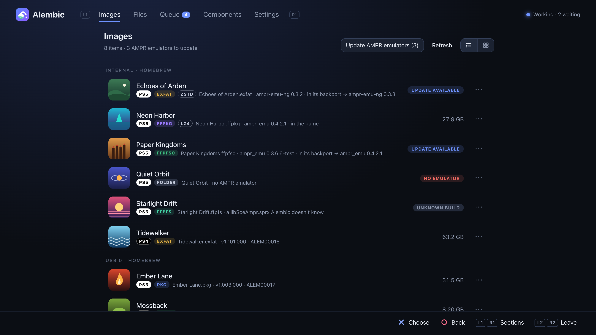

# Alembic

[English](README.md) · [Türkçe](README.tr.md) · [Deutsch](README.de.md) · [Español](README.es.md) · [Français](README.fr.md) · [Magyar](README.hu.md) · [Русский](README.ru.md) · **日本語** · [简体中文](README.zh.md)

*これは [英語の README](README.md) の翻訳です。内容が異なる場合は、英語版が最新です。*


Alembic は、PS5 と PS4 のゲームを homebrew ローダーが使う形式のあいだで変換します。
対応形式は、パッケージ（PS5 のデバッグ FPKG、PS4 の fake PKG）、ダンプフォルダー、exFAT イメージ、FFPKG
（UFS2）、FFPFS（PFS）、FFPFSC（圧縮 PFS）です。**本体上** では、ホーム画面のアプリ
（0.3.0 から）として、または Web ページ付きのペイロードとして動作し、どちらも
コントローラーで操作できます。PC（Windows、macOS、Linux）では、コマンドラインツールとして、または
同じエンジンとページとして動作します。ネットワーク上のエンジンどうしは
ペアリングして連携できます。たとえば PC にあるパッケージを PC のプロセッサーで変換し、
そのまま本体のストレージに書き込めます。PC や NAS 上のゲームは、SMB、NFS、WebDAV、FTP
経由で読み込んだり保存したりすることもできます。

> 開発中です。変換したものは、結果を本体で確認するまでバックアップを残しておいて
> ください。

**これまでに本体で試したこと:** ダンプやパッケージから作った FFPFSC イメージが
ShadowMount+ で動作する。AMPR エミュレーターが必要なゲームは、それを追加すると
起動する。本体と PC がペアリングして互いのために変換する。
**インストール** でデバッグパッケージを本体のインストーラーに渡せる。Alembic がダンプから作った
パッケージ（非圧縮または Kraken、デバッグライセンスを生成するのでタイトルにロックがかからない）も含む。一時停止した
変換が、エンジンのアップデート後に続きから再開する。エンジンがリリースから自身を
アップデートする（Payload Manager から読み込んだ場合）。本体アプリが
ShadowMount+ から起動し、エンジンの起動と再起動を行い、ペアリングした PC 上の
変換を操作する。SMB 共有フォルダーからパッケージを変換する。zstd パックにした
ゲーム（160 GB のパッケージを PC のエンジンがレベル 5 でパックし、本体に書き込んだ
96 GB の exFAT）が ampr-emu-ng で起動する。
パッケージから変換した PS4 ゲームが、ShadowMount+ 1.7beta8 でイメージから起動する
（その際「Trophy registration failed」と表示されますが、これは
ShadowMount+ 側の問題です: [#97](https://github.com/drakmor/ShadowMountPlus/issues/97)）。
**まだのもの:** 本体からの NFS、WebDAV、SMB 暗号化、FTPS、HTTPS、
実際の NAS 機器と Windows の共有フォルダー（いずれも PC 上で
Samba、rclone、WsgiDAV、pyftpdlib を相手に確認済み）。Alembic のパッケージからインストールした
ゲームの起動（インストールは試しましたが、起動はまだです）。Alembic が作った PS4
パッケージ。PS4 のアップデート（パッチパッケージ）と DLC。LZ4 アセットパックは、動くゲームと
動かないゲームがあります。

## できること

| 変換元 ↓ / 変換先 → | フォルダー | exFAT | FFPKG (UFS2) | FFPFS (PFS) | FFPFSC | パッケージ |
|---|:-:|:-:|:-:|:-:|:-:|:-:|
| ダンプフォルダー | – | ✓ | ✓ | ✓ | ✓ | ✓ |
| exFAT | ✓ | ✓ | ✓ | ✓ | ✓ | ✓ |
| FFPKG (UFS2) | ✓ | ✓ | ✓ | ✓ | ✓ | ✓ |
| FFPFS (PFS) | ✓ | ✓ | ✓ | ✓ | ✓ | ✓ |
| FFPFSC | ✓ | ✓ | ✓ | ✓ | ✓ | ✓ |
| PS5 FPKG（デバッグ） | ✓ | ✓ | ✓ | ✓ | ✓ | `--rebuild` |
| PS4 PKG（fake） | ✓ | ✓ | ✓ | ✓ | ✓ | `--rebuild` |

ゲームがどのパッケージになるかは、ゲームによって決まります。PS5 ゲーム（`sce_sys/param.json`）は
PS5 のデバッグ FPKG に、PS4 ゲーム（`sce_sys/param.sfo`）は PS4 の fake PKG になります。ページ
とアプリでは、各ゲームに **PS5**（白）または **PS4**（黒）のラベルが付きます。

- **PS4 ゲーム**（0.3.2 から）: 一般的なオールゼロのパスコードを使った fake PKG は
  （新旧どちらのパッケージングツールで作ったものでも）PS5 パッケージと同じように
  開けます。中身はゲームのファイルと、パッケージ内の `sce_sys`（`param.sfo`、アイコン、
  トロフィー、ライセンス）として見え、どのイメージにも変換できます。PS4 ゲームのイメージと
  フォルダーには、ShadowMount+ が起動に必要とする `sce_sys/param.json` が付きます
  （`param.sfo` から、
  [PS4pkg_to_ffpfsc](https://github.com/SadykovIV/PS4pkg_to_ffpfsc) と同じ方法で
  作ります）。ShadowMount+ 1.7beta8 を使って本体で試しました。どの形式の PS4 ゲームも
  PS4 の fake PKG に戻せます。作り方は
  [LibOrbisPkg](https://github.com/maxton/LibOrbisPkg) の `pkg_build` と同じで、
  ゲームのライセンスはそのまま残し（ない場合だけ生成します）、PlayGo
  ファイルは作り直します。どのイメージから作り直したパッケージも、
  バイト単位で同じになります。鍵は LibOrbisPkg のものを使います（コンポーネント、または
  PC では `--ps4-keys FILE`）。AMPR エミュレーターと LZ4 パックは PS5
  ゲーム専用です。ゲームがどちらの本体向けかはタイトル ID（`CUSA`、
  `PPSA`）から、なければ `eboot.bin` をビルドした SDK から判断します（homebrew の場合）。
  `alembic game-info` で両方を確認できます。まだのもの: アップデートと DLC、および
  オールゼロ以外のパスコードで作ったパッケージ。
- **ストリーミング:** どの入力もファイルツリーとして読み込み、そのまま出力に
  書き込みます。一時コピーを作らないので、100 GB のパッケージでも必要なのは
  結果の分の容量だけです。
- **バイト単位で一致:** 参照ツールと同じ出力になります。exFAT、FFPKG、FFPFSC は
  [PS5PKGTool](https://github.com/pearlxcore/PS5PKGTool) と、FFPFS は
  [MkPFS](https://github.com/PSBrew/MkPFS)（`pack folder --raw
  --no-compress`）と、FPKG の出力は
  [ProsperoPkgTool](https://github.com/pearlxcore/ProsperoPkgTool)
  （`img_create`、非圧縮または `--compression kraken`、同じ固定
  シード）と一致します。PS4 パッケージは
  [LibOrbisPkg](https://github.com/maxton/LibOrbisPkg) の `pkg_build` と一致し、
  `pkg_makegp4` が取り出したプロジェクトからパッケージを作り直す場合も同じです。
- **LZ4 アセットパック:** drakmor の [ampr_emu](https://github.com/drakmor/ampr_emu)
  の PackedStdio ランタイム向け（`--lz4`）。その `ampr_pack.py` とバイト単位で一致し、
  ゲームのプロファイルは
  PS5-LZ4-Compression のものを使います。
- **zstd パック:** quer3q の [ampr-emu-ng](https://github.com/quer3q/ampr-emu-ng) 向け
  （`--zstd`、または変換の **アセットパック** → zstd）。
  [ps5-dump-forge](https://github.com/quer3q/ps5-dump-forge) の出力とバイト単位で一致します。LZ4 より
  小さく、作るのも速くなります（Mac で 26 GiB のゲームファイルが 33 秒で 11.1 GiB に。
  LZ4 では 77 秒で 17.5 GiB）。ゲームには
  ampr-emu-ng の `libSceAmpr.sprx`（コンポーネントから入手）が入ります。ShadowMount+ の
  「update emulators」はオフにしてください。オンのままだと、パックを読めないエミュレーターに置き換えられます。
  レベルは 1、5（デフォルト）、19。PS5 で試しました。パック済みのゲームは、
  変換（**アセットパック**）で LZ4 パックと zstd パックを切り替えられます。古い
  パックはそのまま新しいパックへデコードされます。
- **AMPR エミュレーター:** 本体の APR ファイルリーダーを使うゲームは、イメージやフォルダーから
  起動するのにエミュレーターの `libSceAmpr.sprx` が必要です。
  drakmor の ampr_emu か quer3q の ampr-emu-ng のどちらかです（どちらを使っているかは
  コンポーネントに表示されます）。Alembic は変換時に、または手元にあるゲームに追加します。
  すでにエミュレーターが入っているゲームでは、「AMPR エミュレーターを追加」が
  もう一方への切り替えを提案します。
- **偽署名:** 実行ファイルが署名なしの素の ELF である PS5 ゲームは、
  起動しません。変換の途中でそれらを偽署名した SELF にし、そのことは変換画面で
  事前に表示されます。イメージやフォルダーでは ampr-emu-ng の `make_fself.py` と、
  パッケージでは ProsperoPkgTool の `img_create` とバイト単位で一致します。
- **高速:** 圧縮とパッケージのデコードはすべてのコアを使います。AES、CRC32C、
  SHA-256 は CPU 専用の命令があればそれを使います。zlib はデフォルトでレベル 6
  です（PS5PKGTool と完全に同じ出力にするにはレベル 9）。

## PS5 での使い方

処理はエンジン（`alembic.elf`）が行います。エンジンはペイロードで、操作に使うものを閉じても
動き続けます。操作には、ホーム画面の **Alembic アプリ** か、その Web ページを使います。
ページは本体のブラウザー（エンジンがメディアタブに追加するショートカットから）でも、
ネットワーク上の任意のブラウザーで `http://<console-ip>:5940` を開いても使えます。
アプリとページは同じ内容を表示し、同じように動作します。


**アプリ**（`PPSA99594`、0.3.0 から）のインストール方法は 2 つあります。

1. **ProsperoStore から**（いちばん簡単）: Alembic は
   [ProsperoStore](https://github.com/darkxex/ProsperoStore)（ネイティブ homebrew 向けの
   本体用ストア）に掲載されています（[Alembic のページ](https://prosperostore.net/app/PPSA99594/)）。
   そこからインストールしてください。アップデートもストアが行います。
2. **イメージまたはフォルダーとして**、
   [ShadowMount+](https://github.com/drakmor/ShadowMountPlus) 経由で: リリースから
   `alembic-app-<version>.ffpkg` を `/data/homebrew/` にコピーします（または
   `alembic-app-<version>.zip` をそこに展開し、`PPSA99594` フォルダーを置きます）。ShadowMount+ の
   次回スキャン後に、ホーム画面にタイルが表示されます。

アプリを起動します。応答するエンジンがない場合は、アプリが同梱のエンジンをポート
9021 の ELF ローダーに送ります（同梱していないアプリは、まず GitHub のリリースから
同じバージョンのエンジンをダウンロードし、`SHA256SUMS` で確認します）。

**アプリを使わない場合:**

1. リリースの `alembic-<version>.elf` を本体の ELF ローダーに送ります。
2. メディアタブ（または上のアドレス）から Alembic を開きます。
3. **ファイル** で、本体ストレージ、USB、ネットワークサーバー（SMB、
   NFS、WebDAV、FTP）、またはペアリングしたエンジンのドライブにあるゲームを選び（PS5 と PS4 の
   ゲームはラベルで区別できます）、
   **変換**、**インストール**（パッケージ）、**コピー**、**移動** のいずれかを実行します。変換は
   **形式**、**オプション**、**保存先**、**完了後** と 1 ステップずつ進み、最後に **確認** に
   なります。確認では行の上で ✕ を押すとそのステップに戻ります。**次へ** の上の ✕ はステップを
   そのままにして進み、○ は 1 つ戻り、□ はどのステップからでもキューに追加します。PS5
   ゲームをパッケージに変換する場合は、完了後に本体のインストーラーへ渡せます
   （**完了後にインストール**）。インストーラーが読み込んだ時点でパッケージは削除されます。
   **パッケージを残す** がオンのときは残ります。それまでは容量が必要です。
4. ジョブは **キュー** で 1 つずつ実行されます。一時停止、再開（時間のかかるジョブは
   チェックポイントから続行）、並べ替え、キャンセルができます。ジョブが終わると
   通知が届きます。


ページにはほかにも次の機能があります。

- **コントローラー優先:** 方向キーで移動、✕ で決定、○ で戻る、□ で
  ファイルのオプションを開き、L1/R1 でセクションを切り替え、L2/R2 でリストをページ送りします。
  終了するには L2 + R2 を同時に押してから ○ を押します（ページから本体の
  ブラウザーを閉じることはできません）。設定にコントローラーテストがあります。PC では矢印キー、
  Enter、Esc、S、Q/E、Page Up/Down を使います。
- **場所:** どのフォルダーでも、そのオプションから場所に追加できます。追加した場所は
  レール、保存先、ペアリングしたエンジンに表示されます。
- **ファイルシステム全体:** **設定 → ファイルシステム全体** で、ファイルのドライブに
  **ファイルシステムのルート**（`/`）が加わります。すべてのフォルダー（`/system`、`/user`、`/mnt` など）を
  ドライブと同じように読み書きできます。`/` 直下のフォルダーは名前の変更や削除ができません。
  ペアリングしたエンジンからは引き続きドライブだけが見えます。
  注意: システムファイルを変更すると、本体が起動しなくなることがあります。
- **ホーム画面の画像を小さく**（実験的、既定はオフ）: 変換のオプションで、ゲームの
  `sce_sys/pic0-2.dds` を PNG から BC1 で再エンコードできます。1 ゲームあたり約 12 MB 小さくなり、
  少しだけ鮮明さが落ちます（CLI: `--bc1-pictures`）。1 台の本体では問題なく表示されました。
  お使いの本体での結果は issue #1 で教えてください。
- **名前を変更**（0.4.1 から）: ゲームの名前を変更するとき、現在の名前と並べて、
  タイトル、タイトルID、バージョン、形式から作った名前（`Title [ABCD12345].ffpfsc` など）を
  提案します。選んだ名前はさらに編集できます。形式は **設定 → 名前の形式** で
  自由に変更できます。フィールドは `{title}` `{titleid}`
  `{contentid}` `{version}` `{format}` `{platform}` `{name}`（または
  `[titleid]`）、修飾子は `{title:upper}`、`{title:20}`、
  `{version:short}` など、`<…>` は値がないときに省く部分です。さらに
  形式ごとに、スペースの扱い（そのまま、削除、`_`、`.`、`-`）と
  文字の扱い（そのまま、大文字、小文字）を決められます。ShadowMount+ がマウントするには
  長すぎる名前（`.ffpfsc` の前が 58 バイト、`.exfat`、
  `.ffpkg`、`.ffpfs` の前が 63 バイトを超えるもの）には印が付き、その後に短縮した名前が続きます。
  入力した名前が長すぎる場合は確認します。隠し名（`.name`）は隠したままです。
- **複数ファイルをまとめて操作**（0.4.2 から）: ファイルで □ → **選択…** を選び、✕ で
  行にチェックを付け、□ でチェックした項目の操作を開き、○ で選択を終えます。
  変換（ゲームごとに 1 ジョブ。すでに変換先の形式のゲームは
  除外）、インストール、AMPR エミュレーターを追加、ShadowMount+ から隠す / ShadowMount+ に再び表示、
  形式で名前を変更（変更前 → 変更後を先に表示）、ほかのエンジンに送る、
  コピー、移動、削除ができます。各操作は、それが当てはまるファイルだけを対象にします。
- **パックと隠す**（0.5.0 から）: アセットパックのゲームには、形式の後ろに LZ4 または
  ZSTD のタグが付きます。**隠す** / **表示する**（`.name` への名前の変更と
  その逆）は、パッケージを含むどのファイルやフォルダーにも使えます。イメージには引き続き
  ShadowMount+ から隠す / ShadowMount+ に再び表示があり、こちらは再スキャンも行います。
- **ネットワークサーバー**（設定、0.3.3 から）: PC や NAS 上のゲームを、先に本体へ
  コピーしなくても変換できます。対応しているのは次のとおりです。
  - **SMB**（Windows の共有フォルダー、ほとんどの NAS 機器）: SMB 2 と 3。Windows 11 が
    求める署名に対応し、サーバーや共有フォルダーが求める場合は SMB 3 暗号化（AES-128-GCM または
    -CCM）も使います。ユーザー名とパスワード、または
    ゲストログイン。共有名を空欄にすると、サーバーのすべての共有フォルダーが表示されます。
  - **NFS**（NAS と Linux のエクスポート）: NFSv3。パスワードの代わりに使う
    uid:gid を指定します。エクスポートを空欄にすると、すべてのエクスポートが表示されます。
  - **WebDAV**（NAS、Nextcloud、rclone）: HTTP または HTTPS、Basic または Digest
    ログイン。
  - **FTP**: FTP または FTPS（明示的、またはポート 990 での暗黙的）。

  サーバーはファイルを保存するだけです。エンジンがネットワーク経由でゲームを読み込み、
  変換は自分で行います。exFAT、FFPKG、FFPFS、フォルダーの
  出力はサーバーに保存できます。FFPFSC と PKG の出力は、いったん
  本体に保存されます。**TLS で暗号化** がオンのとき、FTP と WebDAV は
  TLS 1.2 または 1.3（mbedTLS）で通信します。家庭用サーバーの多くは自己署名
  証明書を使うため、Alembic は SSH と同じように、最初の接続時にサーバーの証明書を信頼します。
  最初の接続では SHA-256 フィンガープリントを表示するので、サーバー側のものと
  見比べて確認してください。以降の接続では同じフィンガープリントでなければならず、
  証明書が変わった場合は警告を出して接続を拒否します。処理を PC に任せたい場合は、
  代わりにその PC で Alembic のエンジンを動かしてください（
  [エンジン間の連携](#エンジン間の連携) を参照）。
- **このコンピューターから:** PC のブラウザーで開いたページから、その PC の
  ファイルを共有して本体に変換させることができます。
- **ShadowMount+:** 新しいイメージを再起動なしで認識させたり、変換後に
  変換元を ShadowMount+ から隠したりできます。
- **イメージ:** ShadowMount+ がスキャンするフォルダーにあるすべての
  イメージ、ゲームフォルダー、パッケージ（非表示のものも）をフォルダーごとに
  まとめ、ゲームアイコンのグリッドまたはリストで表示します（上の切り替え
  ボタンで選択。ファイルにも同じボタンがあり、リストで始まります）。
  フォルダーへの移動とコピーを除くファイルと同じ操作ができます: 変換、
  インストール、名前の変更、AMPR エミュレーター、ShadowMount+ から隠す、
  別のエンジンに送る、削除、複数をまとめて選択、そして置かれたフォルダーを
  開く **ファイルで表示**。APR を使うゲームでは、それぞれが使う AMPR
  エミュレーター（ゲーム内または backport 内）と、新しいビルドが出ているかを
  表示します。**AMPR エミュレーターをアップデート** は各ゲームの
  エミュレーターの最新ビルドに置き換え、エミュレーターのないゲームには
  使用中のものを入れます。両エミュレーターの公式ビルドはすべて、GitHub が
  公開する SHA-256 で識別されます。
  アプリが `/data/downloads`（その下のどのフォルダーでも）に
  ダウンロードしたパッケージも表示されます。PC ではシステムの
  ダウンロードフォルダーにあるものです。
  その後にペアリングしたエンジンのイメージがエンジンごとのセクションで
  続きます（送る、変換などはファイルと同じように使えます）。AMPR
  エミュレーターは PS5 上で、その PS5 自身のゲームについてだけ表示・
  アップデートされます。
  PS5 ではページとアプリがイメージで開き、PC ではファイルで開きます。

  
- **コンポーネント:** Alembic が必要とするものの同梱していないサードパーティのファイル（AMPR
  エミュレーターの ampr_emu と ampr-emu-ng、ProsperoPkgTool の FPKG 鍵ファイル、
  LibOrbisPkg のライセンスと PS4 パッケージの鍵）は、求めに応じて
  公式の配布元からダウンロードし、SHA-256 が一致した場合だけ保存します。
  2 つの AMPR エミュレーターは、それぞれのプロジェクトの最新リリースに追従します。エンジンは
  起動時（または **アップデートを確認** を押したとき）に GitHub を確認し、**自動で
  アップデート** がオン（デフォルト）なら新しいビルドをダウンロードします。ビルドは
  GitHub とリリースの `SHA256SUMS` が示す SHA-256 で確認します。エミュレーターは 1 つが
  **使用中** になります。変換と「AMPR エミュレーターを追加」がゲームに入れるのはそれです。
  ゲームには入れたときのビルドが残ります。そのゲームで「AMPR エミュレーターを追加」を選ぶと、
  使用中のものへの置き換えを提案します。ampr-emu-ng は独自の zstd パックも読めます。
  **オフラインの場合:** 下のリンクから PC でダウンロードし（エミュレーターは
  Alembic が最後にテストしたビルドです。同じプロジェクトのそれ以降のリリースでも動作します）、
  本体の次の場所にこのとおりの名前でコピーしてください。エンジンは再起動なしで認識します。

  | コンポーネント | ダウンロード | 置き場所 | SHA-256 |
  |---|---|---|---|
  | AMPR エミュレーター (ampr_emu 0.4.2.1) | [libSceAmpr.sprx](https://github.com/drakmor/ampr_emu/releases/download/0.4.2.1/libSceAmpr.sprx) | `/data/alembic/runtime/libSceAmpr.sprx` | `69e6c4d5e4f5fb83c9e01815db5861c4c75734acbf4595cafa50d4c218116d1a` |
  | AMPR エミュレーター (ampr-emu-ng 0.2.0) | [libSceAmpr.sprx](https://github.com/quer3q/ampr-emu-ng/releases/download/v0.2.0/libSceAmpr.sprx) | `/data/alembic/runtime/ampr-emu-ng/libSceAmpr.sprx` | `7acb2173d9691b5dfb94ea4007660920b7250111c5fd7a86c6eb91b763ad3d76` |
  | FPKG 鍵ファイル | [passcode.bin](https://raw.githubusercontent.com/pearlxcore/ProsperoPkgTool/f2c91cd7a5d8440b7b9ae5e0b1154334093bf613/ProsperoPkgTool/Keys/passcode.bin) | `/data/alembic/keys/passcode.bin` | `81e8283d582f522d8da34565ecd6ab39a38b3d3c0cacef078df97d2b285ec24e` |
  | | [mount_image.bin](https://raw.githubusercontent.com/pearlxcore/ProsperoPkgTool/f2c91cd7a5d8440b7b9ae5e0b1154334093bf613/ProsperoPkgTool/Keys/mount_image.bin) | `/data/alembic/keys/mount_image.bin` | `4510462812321cea26b4c0155e363955b16e31b89252b92510accad02eca5cd0` |
  | | [metadata_modulus.bin](https://raw.githubusercontent.com/pearlxcore/ProsperoPkgTool/f2c91cd7a5d8440b7b9ae5e0b1154334093bf613/ProsperoPkgTool/Keys/metadata_modulus.bin) | `/data/alembic/keys/metadata_modulus.bin` | `4a585ee47fea88d6b121d5e8afc9829438a27ee325cebec56a2ff537129a37c5` |
  | ライセンスと PS4 パッケージの鍵 | [Keys.cs](https://raw.githubusercontent.com/maxton/LibOrbisPkg/643477263b2644e0803e0f58b8726ea4e3f3b7d4/LibOrbisPkg/Util/Keys.cs) | `/data/alembic/keys/ps4/Keys.cs` | `48b44dd03e653a5c0991b0a2975477802ea2639c4e6ea3270b2ff20a1856f8a7` |

  鍵ファイルは固定されたもの（同じ SHA-256）でなければならず、違うものはパッケージ出力で
  拒否されます。鍵は定数なので、何かに追従することはありません。手でコピーした
  エミュレーターのビルドも動作しますが、エンジンが自分でダウンロードするまで、
  コンポーネントでは「変更あり」と表示されます。
- **エンジン**（設定）: **エンジンを再起動** は、ELF ローダー経由で同じバージョンを
  起動し直します。エンジンが停止すると、アプリには **エンジンを起動** も表示されます。
- **アップデート**（0.2.3 から）: エンジンは起動時に GitHub で新しいリリースを探し、
  見つかれば知らせます。**設定 → アップデート** でリリースノートを確認できます。
  **アップデート** はペイロードをダウンロードし、リリースの
  `SHA256SUMS` とペイロード内に書かれたバージョンで確認したうえで、ローダーが起動に使う
  コピーを置き換えます。対象は Payload Manager のもの（新しいバージョン名に変更し、
  そのペイロードの `meta.json` 内の名前も修正）と `ps5_autoloader`
  フォルダーのもの（名前はそのまま）です。**ドライブを検索** でほかの場所のコピーも見つけられます。その後、
  新しいエンジンが ELF ローダー（ポート 9021）経由で起動して処理を引き継ぎます。
  進行状況を保持できる実行中のジョブは続行します。新しい
  `alembic.elf` を手で送った場合も、実行中のエンジンが置き換わります。0.3.0 からは、同じ
  アップデートで、リリースのものと異なる場合はアプリの `.ffpkg` も置き換えます。
  アプリを開いている間は、閉じるまで待ちます（ProsperoStore からインストールした
  アプリはストアがアップデートします）。アプリがエンジンより古い場合はその旨を表示し、
  **アプリをアップデート** を提案します。
- **ほかのエンジン:** ペアリングしたエンジンの電源が切れていても、一覧から消えずに
  オフラインとして表示されます。
- **使用中のドライブ:** 実行中のジョブが使っているドライブからゲームのタイトルと
  アイコンを読み込んでいる間も、アプリはキューを最新の状態に保ちます。
- 言語: English、Türkçe、Deutsch、Español、Français、Magyar、Русский、日本語、简体中文
  （Magyar は isty1974 が翻訳）。

状態（キュー、設定、ダウンロードしたコンポーネント）は `/data/alembic` に保存されます。

## エンジン間の連携

本体のペイロードに加えて、PC でも `alembic-engine` を動かします。
ペアリングすると、それぞれのエンジンが相手のファイルを読み書きし、相手にジョブを任せられます。

1. 両方で **設定 → ほかのエンジン** の **このネットワークのエンジンを探す** を
   オンにする（デフォルトはオフ）か、アドレスを指定してエンジンを追加します。
2. 相手のエンジンの横にある **ペアリング** を押します。相手側に 6 桁のコードが表示されるので
   （PS5 では通知、PC ではウィンドウ）、それを入力します。
   ペアリングしたエンジンは、取り決めた鍵ですべてのリクエストに署名します。
3. 相手のエンジンのドライブと場所が、**ファイル** の
   *ほかのエンジン* の下に、入力元としても保存先としても表示されます。
4. **変換** の **変換するエンジン** で、処理を行うエンジンを
   （現在オンラインのものから）選びます。
   変換元、変換するエンジン、出力先はそれぞれ別の
   エンジンにあってもかまいません。データはエンジン間をストリーミングで流れ、事前のコピーは作りません。

ジョブは、そのファイルを使うすべてのエンジンのキューに表示され（「Living
room PC で実行」）、どのエンジンからでも一時停止、再開、キャンセル、履歴からの消去が
できます。ジョブが出力を確認したあとに変換元を削除する場合、
エンジンどうしはファイルを送り返す代わりに SHA-256 ダイジェストを比較します。変換せずに
エンジン間でファイルを送ることもできます（オプション → ほかのエンジンに送る…）。


バージョンの異なる Alembic のエンジンどうしでも、互いの通信方法が同じであれば
連携できます。リリースで通信方法が変わった場合は、設定にどの
エンジンをアップデートすべきかが表示され、アップデートするまで互いに接続を拒否します。

ページ自体にパスワードはありません。ネットワーク上の誰でも開けます。PC のエンジンを
`--listen 127.0.0.1` 付きで起動すると、そのコンピューターからしか使えなくなります。その場合、ほかの
エンジンからは接続できません。

## ガイド

### どの形式を使うか

| 形式 | 内容 | サイズ | 起動方法 | 向いている用途 | 注意点 |
|---|---|---|---|---|---|
| **パッケージ**（FPKG / PKG） | 本体がインストールする形のゲーム | ゲームと同じ。Kraken 圧縮で小さくなる（PS5） | 本体のインストーラー: 通常のインストール済みゲーム | ローダーも AMPR エミュレーターも使わずにインストールしたいゲーム | インストールには本体ストレージか拡張ストレージにゲーム全体の容量が必要で、インストールが終わるまではパッケージの分も必要 |
| **FFPKG**（UFS2） | UFS2 ファイルシステムを収めた 1 つのイメージファイル | ゲームと同じ | ShadowMount+ | 本体ストレージや USB からのゲームの起動: ShadowMount+ の推奨形式 | ほかのイメージと同じくサイズは固定。ファイルを変えるには、フォルダーに変換してから戻す |
| **exFAT** | exFAT ファイルシステムを収めた 1 つのイメージファイル | ゲームと同じ | ShadowMount+ | 外付けドライブのコンテンツとして扱わないと動かないタイトル（音が出ない、おかしいのがよくある兆候） | ShadowMount+ が勧めるのはそうしたタイトルだけ。`/data` か `/user` の直下にあり、クラスターが 64 KB のとき最も速く読み込む（Alembic は常にそうする） |
| **FFPFSC** | exFAT（またはほかの）イメージを収めた圧縮 PFS コンテナー | 小さくなる: どれだけかはゲームしだい | ShadowMount+（実験的な対応） | 小さめ、軽めのゲームの容量節約 | プレイ中に本体が約 150〜250 MB/s で展開するため、大きなオープンワールドのゲームは本体ストレージからでもカクつくことがある。常に読み取り専用 |
| **FFPFS**（PFS） | 本体独自の PFS ファイルシステムを収めた 1 つのイメージファイル | ゲームと同じ | ShadowMount+（実験的な対応） | PFS を試す、MkPFS の出力に合わせる | ShadowMount+ では実験的 |
| **ダンプフォルダー** | ゲームのファイルそのまま | ゲームと同じ、ファイルごとに少し増える | ShadowMount+ | ファイルの変更（MOD、backport）、ほかの形式を作る元として。読み込みが最も速いことが多い | ファイルが数千あるため、1 つのイメージよりコピーや移動が遅い |

**まとめ:**

- **ほかのゲームと同じようにインストールするには:** パッケージに変換するか、
  **インストール…** を使います。変換、インストール、パッケージの削除まで行います。
  インストールしたゲームは本体自身の APR を使うので、AMPR エミュレーターは
  不要です（Alembic で作ったパッケージのインストールは試してありますが、
  そこからインストールしたゲームの起動はまだ試していません）。
- **ShadowMount+ でゲームを動かすには:** まず **FFPKG**。FFPKG でゲームの
  動作がおかしい場合（音など）は **exFAT** にし、ShadowMount+ が exFAT を
  最も速く読み込む `/data`（または `/user`）の直下に置きます。
- **容量が足りないとき:** 方法は 2 つあり、組み合わせることもできます。
  - **zstd パック**（変換の **アセットパック**）は、イメージの読み込みを速く保ったまま
    ゲームのファイルを小さくします。26 GiB のゲームファイルが 11.1 GiB になり、
    LZ4 パックより約 3 分の 1 小さくなりました。その場合ゲームには ampr-emu-ng が
    必要で、ShadowMount+ の「update emulators」をオフにしないと ampr_emu に
    戻されます。ampr-emu-ng は新しく変化も速いため、まだすべてのゲームが
    動くわけではありません。元のゲームを削除する前に起動を確かめてください。
  - **LZ4 パック** はどちらのエミュレーターでも動きます（ampr-emu-ng も
    読めます）が、サイズは大きく、ampr_emu で動くのは一部のゲームだけです。
  - **FFPFSC** はイメージ全体を圧縮し、エミュレーターは不要ですが、本体での
    展開が遅くなります。小さめのゲームなら問題ありませんが、大きなオープン
    ワールドのゲームはカクつくことがあります。その場合は FFPKG か exFAT に
    戻してください。
- **ゲームのファイルを変更するには:** **フォルダー** のままにしておき、
  終わったらイメージに変換します。

### やり方

- **パッケージを ShadowMount+ 用のイメージにする:** ファイル（またはイメージ）で
  パッケージを選んで **変換…** を押し、形式を選びます（迷ったら FFPKG。上を参照）。
  ShadowMount+ がスキャンするフォルダー（`/data/homebrew` など）に保存します。
  **変換元を ShadowMount+ から隠す** を使うと、ゲームをアンインストールせずに
  ShadowMount+ が新しいイメージに切り替えます。
- **イメージやフォルダーをパッケージとしてインストールする:** それに対して
  **インストール…**（PS5 のエンジン）を選びます。パッケージに変換され、
  インストーラーに渡され、インストール後に削除されます（**パッケージを残す** で
  残せます）。
- **PC で変換し、本体に保存する:** エンジンをペアリングし（設定 → ほかのエンジン）、
  本体のファイルで PC のファイルを選び、変換するエンジンに PC を選びます。
  処理は PC のプロセッサーが行い、結果は本体のストレージに直接書き込まれます。
- **AMPR エミュレーターを最新に保つ:** イメージには各ゲームのエミュレーターと、
  新しいビルドが出ているときの印が表示されます。**AMPR エミュレーターを
  アップデート** で、それぞれの種類のまま、すべてをアップデートします。
- **変換後に容量を空ける:** **完了後に元データを削除** は、削除する前に結果と
  変換元をファイルごとに比較します。

### ヒント

- **できるだけ PC で変換する。** 本体がペイロードに与えるのはプロセッサーの
  一部（低い優先度で約 5 コア）だけです。PC のエンジンなら数倍速く変換し、
  ネットワーク経由で本体に書き込みます。
- **時間のかかる変換は中断して再開できます。** 一時停止して、エンジンを
  アップデートまたは再起動しても、最後のチェックポイントから続行します。
- **イメージにいつも同じ形の名前を付ける:** 設定 → 名前の形式 で、タイトル、
  タイトルID、バージョン、形式を好きなように組み合わせられます。
- **複数を選ぶ:** ファイルかイメージで オプション → 選択… を選び、ゲームに
  チェックを付けてから、□ ですべてに対する操作を選びます。
- **元のゲームを削除する前にバックアップを。** 新しいイメージが本体で
  起動することを確かめるまでは残しておいてください。

## PC での使い方

各リリースには、システムごとのパッケージがあります: `alembic-<version>-linux-x64.tar.gz`、
`-macos-arm64.tar.gz`（Apple シリコン）、`-windows-x64.zip`。どれにも
`alembic` と `alembic-engine` が入っています。macOS 版は署名されていません。ブラウザーで
ダウンロードしたあと、そのフォルダーで `xattr -d com.apple.quarantine alembic
alembic-engine` を一度実行してください。実行しないと macOS が起動を拒否します。

```sh
alembic convert game.pkg game.ffpfsc              # format from the extension (PS5 or PS4 package)
alembic convert ps4game.exfat game.pkg --ps4-keys Keys.cs   # a PS4 game back to a PS4 fake PKG
alembic convert game.exfat game/ --to folder      # unpack to a folder
alembic convert game/ game.exfat --lz4 --lz4-runtime libSceAmpr.sprx
alembic convert game/ game.exfat --zstd --zstd-runtime libSceAmpr.sprx   # ampr-emu-ng's
alembic ls game.ffpkg                             # list the files of any input
alembic same game.pkg game.ffpfsc                 # compare two inputs file by file
alembic game-info game.exfat                      # title ID, SDK and PS4 or PS5
alembic --help                                    # every command and option
```

`alembic-engine` はペイロードと同じエンジンで、同じ Web ページ
（`http://localhost:5940`）を持ちます。PC での変換や、本体とのペアリングに使います。
`--root DIR`（複数指定可）で共有するフォルダーを選びます（デフォルトは
ホームフォルダー）。ほかのオプションは `alembic-engine --help` で確認できます。
新しいリリースが出ると設定 → アップデートに表示されます。PC では、自分でダウンロードして
ファイルを置き換えてください。

## ビルド

必要なもの: CMake 3.20 以降、C++20 コンパイラー、zlib（PS5 向けは同梱）、
エンジンの Web ページ用に Node.js 20 以降と npm（`src/engine/web`。Preact と
TypeScript を esbuild でバンドルします。初回のビルドではそこで `npm ci` を実行します）。

```sh
cmake -S . -B build -DCMAKE_BUILD_TYPE=Release
cmake --build build -j
./build/alembic_tests
```

Windows 版（`alembic.exe`、`alembic-engine.exe`）は、macOS または Linux 上で
[llvm-mingw](https://github.com/mstorsjo/llvm-mingw) を使ってクロスビルドします。
実行ファイルは静的リンクされているので、Windows 10 以降でそのまま
動作します。`tools/windows/smoke.sh` で Windows（Git Bash）上の動作を確認できます。

```sh
cmake -S . -B build-win -DCMAKE_BUILD_TYPE=Release -DCMAKE_TOOLCHAIN_FILE=cmake/mingw-w64-x86_64.cmake \
      -DLLVM_MINGW=/path/to/llvm-mingw
cmake --build build-win -j
```

PS5 のペイロードには LLVM 18 と
[ps5-payload-dev/sdk](https://github.com/ps5-payload-dev/sdk) v0.44 が必要です。

```sh
# macOS: brew install llvm@18 · Debian/Ubuntu: apt install clang-18 lld-18 llvm-18
export PS5_PAYLOAD_SDK=/path/to/ps5-payload-sdk   # default: .refs/ps5-payload-sdk
tools/ps5/build.sh                                # → build-ps5/alembic.elf
```

GitHub Actions は、ドキュメント以外の変更を含むプッシュのたびに、すべてをビルドしてテストします
（[.github/workflows/build.yml](.github/workflows/build.yml) を参照）。
各実行では、ペイロード単体の `alembic-<version>.elf` と、
バンドル `alembic-<version>.zip` をダウンロードできます。バンドルには、`ps5/` にペイロード、`linux-x64/`、`macos-arm64/`、`windows-x64/`（`.exe`）に
`alembic` と `alembic-engine` が入っており、
README とライセンスファイルも含まれます。バージョンはタグ（`v0.1.0`）、タグがなければブランチ名とコミット
（`main-a2fab12`）です。`v*` タグを付けると、ペイロード、バンドル、PC の
システムごとのパッケージ、本体アプリ（`.ffpkg` と `.zip`）、`SHA256SUMS` がリリースとして公開されます。
0.3.1 からは、すべてのリリースファイルにビルド証明（attestation）が付いています。`gh attestation
verify <file> --repo fthdgn-gh/Alembic` を実行すると、このリポジトリのワークフローが
どのコミットからビルドしたかを確認できます。

### Web ページ

エンジンのページは `src/engine/web` にあります。TypeScript で書いた Preact コンポーネント
（`src/pages/` にセクションごとのフォルダーがあり、残りは `src/main.tsx` が割り当てます）を、
PS5 の古いブラウザー向けに 1 つの HTML ファイルにバンドルし、エンジンに
埋め込みます。ページを開発するときは、エンジンを動かし、変更のたびにページを
再ビルドさせます。

```sh
build/alembic-engine --listen 127.0.0.1 &   # its API, on port 5940
cd src/engine/web
node build.mjs --serve                      # the page at http://127.0.0.1:5950
npx tsc --noEmit                            # type check (CI runs it too)
python3 ../../../tools/i18n_keys.py --check # every text translated
```

`tools/screenshots/shoot.sh` は、架空のゲームを持つ代用エンジンを相手に、README の
スクリーンショットを作ります。

### 参照ツールとの照合

`tools/` のスクリプトは、Alembic の出力を、手本にしたツールの出力とバイト単位で
比較します。参照プロジェクトを `.refs/`（git では無視）にチェックアウトしておく
必要があります。作り直し方は [docs/NOTES.md](docs/NOTES.md) にあります。

```sh
tools/oracle/compare.sh        # exFAT, FFPKG, FFPFS, FFPFSC vs PS5PKGTool and MkPFS
tools/pkg-oracle/compare.sh    # FPKG reading and writing vs ProsperoPkgTool / LibProsperoPKG
tools/pkg-oracle/write_samples.sh  # FPKG writing vs ProsperoPkgTool on your own packages
tools/lz4-oracle/compare.sh    # LZ4 packs vs ampr_emu's ampr_pack.py
tools/zstd-oracle/compare.sh   # zstd packs vs ps5-dump-forge (builds it with cargo)
tools/fself-oracle/compare.sh  # fake-signed SELFs vs ampr-emu-ng's make_fself.py
tools/ps4-oracle/compare.sh    # PS4 packages vs LibOrbisPkg's pkg_build, pkg_extract and pkg_validate
```

## Alembic に含まれないもの

- このリポジトリにもバイナリにも、Oodle、`libScePubTools`、クローズドソースのパッケージライブラリ、本体の鍵は
  含まれていません。FPKG の出力には ProsperoPkgTool が
  公開している鍵ファイルを、PS4 パッケージの出力には LibOrbisPkg の `Keys.cs` を使います（これには
  デバッグライセンスの鍵も含まれており、ライセンスのない PS5 または PS4
  ゲームにライセンスを生成するときだけ使います）。エンジンはどちらも求めに応じてダウンロードします。
- サードパーティのバイナリは含まれていません。AMPR エミュレーターの `libSceAmpr.sprx` は、
  各プロジェクトの公式 GitHub リリースからダウンロードし、一緒に公開されている
  SHA-256 で確認します。

## クレジット

Alembic は PS5 homebrew シーンの成果の上に成り立っています。以下の皆さんに感謝します。

- **pearlxcore**: [PS5PKGTool](https://github.com/pearlxcore/PS5PKGTool)
  （exFAT、PFSC、FFPFSC。Alembic がバイト単位で一致させている参照ツール）と
  [ProsperoPkgTool](https://github.com/pearlxcore/ProsperoPkgTool)（デバッグパッケージの
  読み書きと、その鍵ファイル）。
- **SadykovIV**: [PS4pkg_to_ffpfsc](https://github.com/SadykovIV/PS4pkg_to_ffpfsc)
  （ShadowMount+ 向けに PS4 ゲームのイメージをどう作るべきか、その `param.json`）。
- **SvenGDK**: [UFS2Tool](https://github.com/SvenGDK/UFS2Tool)（FFPKG の
  読み込みと書き込み）と [LibProsperoPKG](https://github.com/SvenGDK/LibProsperoPKG)
  （テスト用パッケージ）。
- **drakmor**: [ampr_emu](https://github.com/drakmor/ampr_emu)（AMPR
  インデックス、LZ4 アセットパック、それを読むランタイム）と
  [ShadowMountPlus](https://github.com/drakmor/ShadowMountPlus)（Alembic のイメージが
  対象とするローダーと、その HTTPS ダウンロードのコード）。
- **quer3q**: [ampr-emu-ng](https://github.com/quer3q/ampr-emu-ng)（2 つ目の
  AMPR エミュレーターと、その zstd パック）と
  [ps5-dump-forge](https://github.com/quer3q/ps5-dump-forge)（Alembic が手本にし、照合にも使う
  zstd パックの書き込みツール）。
- **PSBrew**: [MkPFS](https://github.com/PSBrew/MkPFS)（PFS の書き込みツール）。
- **maxton**: [LibOrbisPkg](https://github.com/maxton/LibOrbisPkg)（PS4
  パッケージ: Alembic が手本にした書き込み処理、その鍵、照合に使う
  ツール）。
- **theghostonline**:
  PS5-LZ4-Compression
  （LZ4 パックのプロファイルと、エンジンと Web ページという構成のアイデア）。
- **danthespal**:
  [MkPFS.CSharp](https://github.com/danthespal/MkPFS.CSharp) とともに公開された LZ4 ゲームプロファイル。
- **ps5-payload-dev**: [PS5 payload SDK](https://github.com/ps5-payload-dev/sdk)、
  [shsrv](https://github.com/ps5-payload-dev/shsrv)（パッケージのインストール）、
  [websrv](https://github.com/ps5-payload-dev/websrv)（メディアタブのショートカット）。
  あわせて [owendswang/ps5-web-file-manager](https://github.com/owendswang/ps5-web-file-manager)
  と [itsPLK/ps5-payload-manager](https://github.com/itsPLK/ps5-payload-manager)。
- **blackbearreloaded**: [ps5-homebrew-ui](https://github.com/blackbearreloaded/ps5-homebrew-ui)
  （ページが従っているデザイン）。
- Microsoft の [オープン仕様](https://learn.microsoft.com/openspecs/)
  （SMB2/3、NTLM、SPNEGO、DCE/RPC、共有フォルダーの一覧）と、NFSv3、ONC RPC、WebDAV の
  IETF RFC。ネットワーククライアントはこれらをもとに書かれています。
- エンジンに同梱している [zlib](https://zlib.net)、[LZ4](https://github.com/lz4/lz4)、
  [Zstandard](https://github.com/facebook/zstd)、およびページにバンドルしている
  [Preact](https://github.com/preactjs/preact) とその
  [signals](https://github.com/preactjs/signals)。

スクリーンショットのゲーム、エンジン、アドレスは架空のものです
（`tools/screenshots/shoot.sh` が代用エンジンを相手に描画しています）。

## ライセンス

GPL-3.0-or-later（[LICENSE](LICENSE)）。Alembic は、複数の GPL、
LGPL、MIT、BSD プロジェクトからコードを移植しています。[THIRD_PARTY_NOTICES.md](THIRD_PARTY_NOTICES.md) に、
それぞれのプロジェクト、そこから取り入れたもの、そのライセンスを記載しています。
