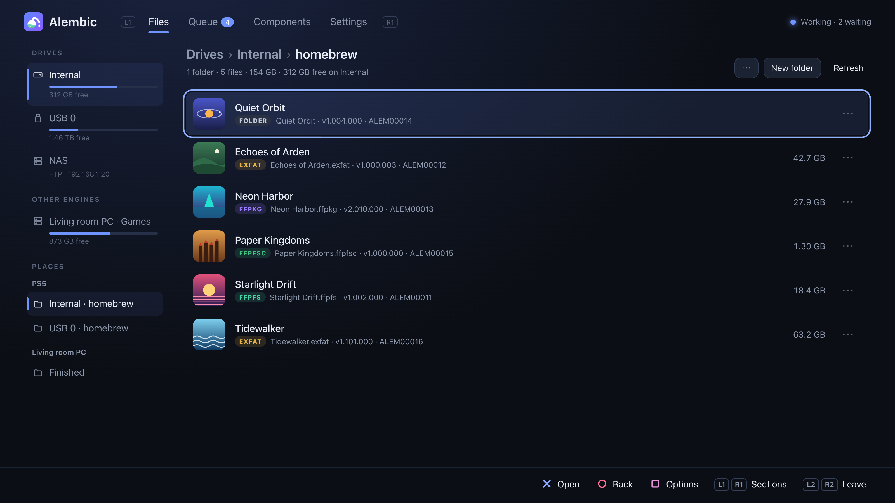
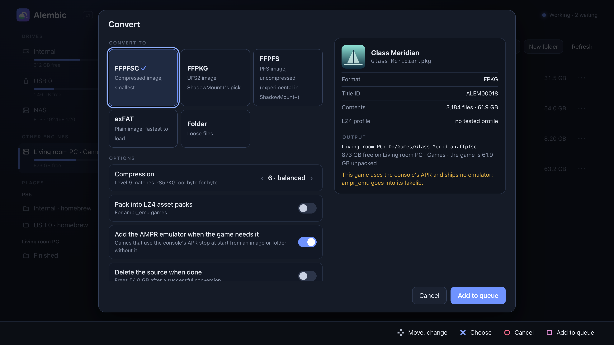
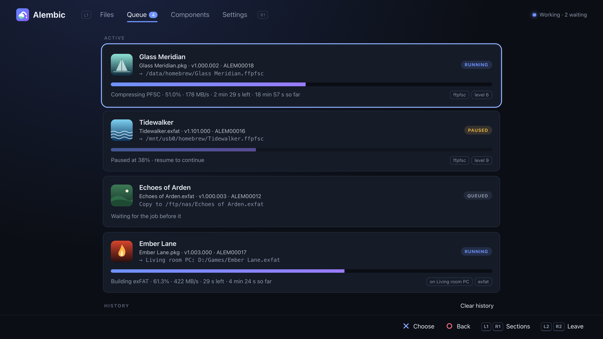
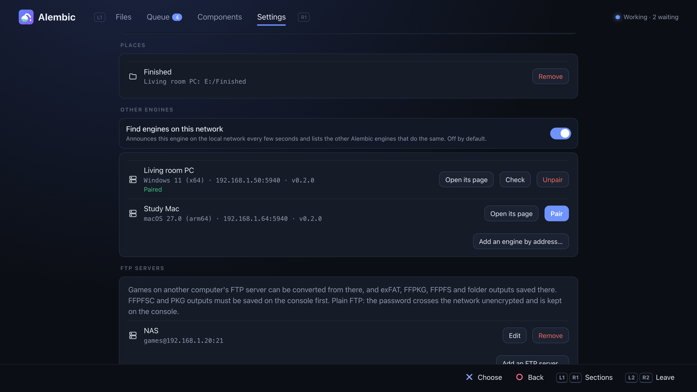

# Alembic



Alembic converts PS5 games between the formats homebrew loaders use: debug
packages (FPKG), dump folders, exFAT images, FFPKG (UFS2), FFPFS (PFS) and
FFPFSC (compressed PFS). It runs **on the console** as a payload with a web
page you drive with the controller, and on a PC (Windows, macOS, Linux) as a
command-line tool or the same engine and page. Engines on your network can
pair and work together: convert a package that sits on your PC, on the PC's
processor, straight into the console's storage.

> Work in progress. Back up anything you convert until you have checked the
> result on your console.

**Tried on a console so far:** FFPFSC images made from dumps and from
packages run through ShadowMount+; games that need the AMPR emulator start
once it is added; the console and a PC pair and convert for each other;
**Install** hands a debug package to the console's installer; a paused
conversion carries on after the engine is updated.
**Not yet:** installing an FPKG that Alembic built. LZ4 asset packs work for
some games and not for others.

## What it does

| From ↓ / To → | Folder | exFAT | FFPKG (UFS2) | FFPFS (PFS) | FFPFSC | FPKG |
|---|:-:|:-:|:-:|:-:|:-:|:-:|
| Dump folder | – | ✓ | ✓ | ✓ | ✓ | ✓ |
| exFAT | ✓ | ✓ | ✓ | ✓ | ✓ | ✓ |
| FFPKG (UFS2) | ✓ | ✓ | ✓ | ✓ | ✓ | ✓ |
| FFPFS (PFS) | ✓ | ✓ | ✓ | ✓ | ✓ | ✓ |
| FFPFSC | ✓ | ✓ | ✓ | ✓ | ✓ | ✓ |
| FPKG (debug) | ✓ | ✓ | ✓ | ✓ | ✓ | – |

- **Streams:** every input is read as a file tree and written straight to
  the output, with no temporary copies, so a 100 GB package needs only the
  space of the result.
- **Byte-identical** to the reference tools: exFAT, FFPKG and FFPFSC match
  [PS5PKGTool](https://github.com/pearlxcore/PS5PKGTool); FFPFS matches
  [MkPFS](https://github.com/PSBrew/MkPFS) (`pack folder --raw
  --no-compress`); FPKG output matches
  [ProsperoPkgTool](https://github.com/pearlxcore/ProsperoPkgTool)
  (`img_create`, stored, with the same fixed seed).
- **LZ4 asset packs** for drakmor's [ampr_emu](https://github.com/drakmor/ampr_emu)
  PackedStdio runtime (`--lz4`), byte-identical to its `ampr_pack.py`, with
  game profiles from
  [PS5-LZ4-Compression](https://github.com/theghostonline/PS5-LZ4-Compression).
- **AMPR emulator:** games that use the console's APR file reader need
  ampr_emu's `libSceAmpr.sprx` to start from an image or folder. Alembic
  adds it when converting, or to a game you already have.
- **Fast:** compression and package decoding use every core; AES, CRC32C
  and SHA-256 use the CPU's own instructions where it has them; zlib level 6
  by default (level 9 for exact PS5PKGTool output).

## On the PS5

The engine (`alembic.elf`) runs as a payload and keeps working after you
close the browser. Its page opens in the console's browser, from a shortcut
it adds to the Media tab, or from any browser on your network at
`http://<console-ip>:5940`.

1. Send `alembic-<version>.elf` (from the releases) to your console's ELF loader.
2. Open Alembic from the Media tab (or the address above).
3. In **Files**, pick a game on internal storage, USB, an FTP server or a
   paired engine's drive, then **Convert**, **Install** (packages), **Copy**
   or **Move**.
4. Jobs run one at a time in **Queue**: pause, resume (long jobs continue
   from a checkpoint), reorder, cancel. You get a notification when one
   finishes.





Also on the page:

- **Controller first:** the D-pad moves, ✕ chooses, ○ goes back, □ opens a
  file's options, L1/R1 switch sections and L2/R2 page through lists. To
  leave, press L2 + R2 together, then ○ (a page cannot close the console's
  browser itself). Settings has a controller test. On a PC: arrow keys,
  Enter, Esc, S, Q/E and Page Up/Down.
- **Places:** add any folder to Places from its Options; they show in the
  rail, in Save to, and on paired engines.
- **FTP servers** (Settings): games on a PC or NAS that runs an FTP server
  can be converted without copying them to the console first. The server
  only stores the files: the engine reads the game over the network and does
  the converting itself. exFAT, FFPKG, FFPFS and folder outputs can be saved
  back to the server. To have a PC do the work, run Alembic's engine on it
  instead (see [Working across engines](#working-across-engines)).
- **From this computer:** opened in a PC's browser, the page can share a
  file from that PC for the console to convert.
- **ShadowMount+:** new images can be picked up without a restart, and
  sources can be hidden from it once converted.
- **Components:** third-party files Alembic needs but doesn't ship (ampr_emu's
  runtime, ProsperoPkgTool's FPKG key files) are downloaded on request from
  their official source and kept only if their SHA-256 matches.
- **Updates** (from 0.2.3): the engine looks for a newer release on GitHub
  when it starts and says so; **Settings → Updates** shows its notes.
  **Update** downloads the payload, checks it against the release's
  `SHA256SUMS` and the version written inside it, and replaces the copies
  your loader starts it from: Payload Manager's (renamed to the new version,
  with the name fixed in that payload's `meta.json`) and `ps5_autoloader`
  folders (same name); **Search the drives** finds copies elsewhere. Then
  the new engine starts through the ELF loader (port 9021) and takes over;
  a running job that keeps its progress continues. Sending a newer
  `alembic.elf` by hand also replaces a running engine.
- Languages: English, Español, Français, Deutsch, 日本語, Türkçe.

State (queue, settings, downloaded components) is kept in `/data/alembic`.

## Working across engines

Run `alembic-engine` on a PC as well as the payload on the console. Once
paired, each engine can read and write the other's files and hand it jobs.

1. In **Settings → Other engines**, switch on **Find engines on this
   network** on both (off by default), or add one by its address.
2. Press **Pair** next to the other engine. It shows a six-digit code
   (on the PS5 as a notification, on a PC in its window); type it in.
   Paired engines sign every request with the key they agreed on.
3. The other engine's drives and Places appear in **Files** under
   *Other engines*, as inputs and as places to save to.
4. In **Convert**, **Convert on** picks the engine that does the work (of
   those online right now). The
   source, the converting engine and the output can each be on a different
   engine; data streams between them, with no copy made first.

A job shows in the queue of every engine whose files it uses ("on Living
room PC"), and can be paused, resumed, cancelled or cleared from the history
on any of them. When a job deletes its source after checking the output,
engines compare SHA-256 digests instead of sending the files back. Files can also be sent between
engines without converting (Options → Send to another engine).



Engines of different Alembic versions work together as long as they talk to
each other the same way; when that changes in a release, Settings shows which
engine to update, and they refuse each other until it is.

The page itself has no password: anyone on your network can open it. Start
a PC engine with `--listen 127.0.0.1` to keep it to that computer; other
engines can't reach it then.

## On a PC

Each release has a package per system: `alembic-<version>-linux-x64.tar.gz`,
`-macos-arm64.tar.gz` (Apple silicon) and `-windows-x64.zip`, each with
`alembic` and `alembic-engine`. The macOS builds are not signed: after a
download from a browser, run `xattr -d com.apple.quarantine alembic
alembic-engine` once in their folder, or macOS refuses to start them.

```sh
alembic convert game.pkg game.ffpfsc              # format from the extension
alembic convert game.exfat game/ --to folder      # unpack to a folder
alembic convert game/ game.exfat --lz4 --lz4-runtime libSceAmpr.sprx
alembic ls game.ffpkg                             # list the files of any input
alembic same game.pkg game.ffpfsc                 # compare two inputs file by file
alembic --help                                    # every command and option
```

`alembic-engine` is the same engine as the payload, with the same web page
(`http://localhost:5940`), for converting on a PC or pairing with the
console. `--root DIR` (repeatable) chooses the folders it shares (your
home folder by default); `alembic-engine --help` lists the other options.
Settings → Updates says when a newer release is out; on a PC, download it
and replace the files yourself.

## Building

Requirements: CMake 3.20+, a C++20 compiler, zlib (bundled for the PS5), and
Node.js 20+ with npm for the engine's web page (`src/engine/web`, Preact and
TypeScript bundled by esbuild; the first build runs `npm ci` there).

```sh
cmake -S . -B build -DCMAKE_BUILD_TYPE=Release
cmake --build build -j
./build/alembic_tests
```

Windows (`alembic.exe`, `alembic-engine.exe`) is cross-built with
[llvm-mingw](https://github.com/mstorsjo/llvm-mingw) from macOS or Linux; the
executables are statically linked and run on Windows 10 and later as they
are. `tools/windows/smoke.sh` checks them on Windows (Git Bash).

```sh
cmake -S . -B build-win -DCMAKE_BUILD_TYPE=Release -DCMAKE_TOOLCHAIN_FILE=cmake/mingw-w64-x86_64.cmake \
      -DLLVM_MINGW=/path/to/llvm-mingw
cmake --build build-win -j
```

The PS5 payload needs LLVM 18 and
[ps5-payload-dev/sdk](https://github.com/ps5-payload-dev/sdk) v0.44:

```sh
# macOS: brew install llvm@18 · Debian/Ubuntu: apt install clang-18 lld-18 llvm-18
export PS5_PAYLOAD_SDK=/path/to/ps5-payload-sdk   # default: .refs/ps5-payload-sdk
tools/ps5/build.sh                                # → build-ps5/alembic.elf
```

GitHub Actions builds and tests everything on every push that changes more
than the docs (see [.github/workflows/build.yml](.github/workflows/build.yml)).
Each run has the payload as a download of its own, `alembic-<version>.elf`,
and a bundle, `alembic-<version>.zip`: the payload in `ps5/`, `alembic` and
`alembic-engine` in `linux-x64/`, `macos-arm64/` and `windows-x64/` (`.exe`),
with the README and license files. The version is the tag (`v0.1.0`), else the branch and commit
(`main-a2fab12`). A `v*` tag publishes the payload, the bundle, a package per
PC system and `SHA256SUMS` as a release.

### The web page

The engine's page is `src/engine/web`: Preact components in TypeScript
(`src/pages/` has one folder per section; `src/main.tsx` maps the rest),
bundled for the PS5's older browser into one HTML file that the engine
embeds. To work on it, run an engine and let the page rebuild on every
change:

```sh
build/alembic-engine --listen 127.0.0.1 &   # its API, on port 5940
cd src/engine/web
node build.mjs --serve                      # the page at http://127.0.0.1:5950
npx tsc --noEmit                            # type check (CI runs it too)
python3 ../../../tools/i18n_keys.py --check # every text translated
```

`tools/screenshots/shoot.sh` makes the README's screenshots against a
stand-in engine with made-up games.

### Checking against the reference tools

The scripts in `tools/` compare Alembic's output byte for byte with the tools
it follows. They need the reference projects checked out in `.refs/`
(git-ignored); [docs/NOTES.md](docs/NOTES.md) says how to recreate it.

```sh
tools/oracle/compare.sh        # exFAT, FFPKG, FFPFS, FFPFSC vs PS5PKGTool and MkPFS
tools/pkg-oracle/compare.sh    # FPKG reading vs packages built by ProsperoPkgTool / LibProsperoPKG
tools/lz4-oracle/compare.sh    # LZ4 packs vs ampr_emu's ampr_pack.py
```

## What Alembic does not include

- No Oodle, `libScePubTools`, closed-source package libraries or console keys.
  FPKG output uses ProsperoPkgTool's published key files, which the engine
  downloads on request.
- No third-party binaries: ampr_emu's `libSceAmpr.sprx` is downloaded from its
  official release, pinned by SHA-256.

## Credits

Alembic stands on the work of the PS5 homebrew scene. Thank you to:

- **pearlxcore** for [PS5PKGTool](https://github.com/pearlxcore/PS5PKGTool)
  (exFAT, PFSC and FFPFSC; the reference Alembic matches byte for byte) and
  [ProsperoPkgTool](https://github.com/pearlxcore/ProsperoPkgTool) (reading
  and writing debug packages, and its key files).
- **SvenGDK** for [UFS2Tool](https://github.com/SvenGDK/UFS2Tool) (the FFPKG
  reader and writer) and [LibProsperoPKG](https://github.com/SvenGDK/LibProsperoPKG)
  (test packages).
- **drakmor** for [ampr_emu](https://github.com/drakmor/ampr_emu) (the AMPR
  index, LZ4 asset packs and the runtime that reads them) and
  [ShadowMountPlus](https://github.com/drakmor/ShadowMountPlus) (the loader
  Alembic's images are made for, and its HTTPS download code).
- **PSBrew** for [MkPFS](https://github.com/PSBrew/MkPFS) (the PFS writer).
- **theghostonline** for
  [PS5-LZ4-Compression](https://github.com/theghostonline/PS5-LZ4-Compression)
  (LZ4 pack profiles and the engine-and-page idea).
- **danthespal** for the LZ4 game profiles posted with
  [MkPFS.CSharp](https://github.com/danthespal/MkPFS.CSharp).
- **ps5-payload-dev** for the [PS5 payload SDK](https://github.com/ps5-payload-dev/sdk),
  [shsrv](https://github.com/ps5-payload-dev/shsrv) (package installs) and
  [websrv](https://github.com/ps5-payload-dev/websrv) (the Media-tab shortcut),
  with [owendswang/ps5-web-file-manager](https://github.com/owendswang/ps5-web-file-manager)
  and [itsPLK/ps5-payload-manager](https://github.com/itsPLK/ps5-payload-manager).
- **blackbearreloaded** for [ps5-homebrew-ui](https://github.com/blackbearreloaded/ps5-homebrew-ui),
  the design the page follows.
- [zlib](https://zlib.net) and [LZ4](https://github.com/lz4/lz4), bundled
  with the engine, and [Preact](https://github.com/preactjs/preact) with its
  [signals](https://github.com/preactjs/signals), bundled into its page.

The games, engines and addresses in the screenshots are made up
(`tools/screenshots/shoot.sh` renders them against a stand-in engine).

## License

GPL-3.0-or-later ([LICENSE](LICENSE)). Alembic ports code from several GPL,
MIT and BSD projects; [THIRD_PARTY_NOTICES.md](THIRD_PARTY_NOTICES.md) lists
each one, what was taken from it, and its license.
