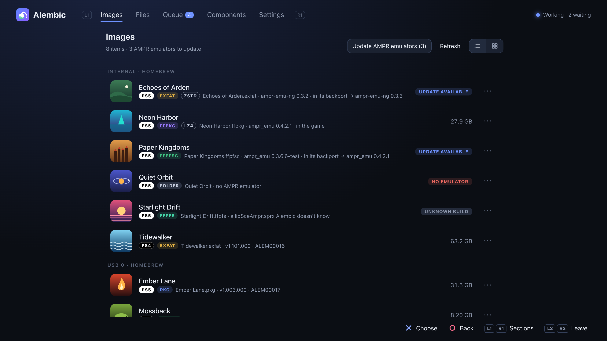

# Alembic

[English](README.md) · [Türkçe](README.tr.md) · [Deutsch](README.de.md) · [Español](README.es.md) · [Français](README.fr.md) · [Magyar](README.hu.md) · **Русский** · [日本語](README.ja.md) · [简体中文](README.zh.md)

*Это перевод [английского README](README.md); если они расходятся, актуален английский.*


Alembic преобразует игры PS5 и PS4 между форматами, с которыми работают
homebrew-загрузчики: пакеты (отладочный FPKG для PS5, fake PKG для PS4),
папки дампов, образы exFAT, FFPKG (UFS2), FFPFS (PFS) и FFPFSC (сжатый PFS).
Он работает **на консоли** — как приложение на начальном экране (с 0.3.0)
или как пейлоад с веб-страницей, и то и другое управляется контроллером, —
а на ПК (Windows, macOS, Linux) как утилита командной строки или тот же
движок со страницей. Движки в вашей сети можно связать, и они будут работать
вместе: например, пакет, лежащий на ПК, преобразуется процессором ПК прямо
в хранилище консоли. Игры на ПК или NAS можно также читать и сохранять по
SMB, NFS, WebDAV или FTP.

> Проект в разработке. Делайте резервные копии всего, что преобразуете,
> пока не проверите результат на консоли.

**Что уже проверено на консоли:** образы FFPFSC, сделанные из дампов и из
пакетов, запускаются через ShadowMount+; игры, которым нужен эмулятор AMPR,
запускаются после его добавления; консоль и ПК связываются и выполняют
преобразования друг для друга; **Установить** передаёт отладочный пакет
установщику консоли, в том числе пакеты, которые Alembic собрал из дампа
(без сжатия или Kraken, с созданной отладочной лицензией, так что игра не
заблокирована); приостановленное преобразование продолжается после
обновления движка; движок обновляется из выпуска (при загрузке через Payload
Manager); приложение для консоли запускается из ShadowMount+, запускает и
перезапускает движок и управляет преобразованием на связанном ПК; пакет
преобразован из общей папки SMB; игра в архивах zstd (пакет на 160 ГБ,
упакованный движком на ПК с уровнем 5 в exFAT на 96 ГБ, записанный на
консоль) запускается с ampr-emu-ng. Игры PS4, преобразованные из их пакетов,
запускаются из образов через ShadowMount+ 1.7beta8 (для них он показывает
«Trophy registration failed»: это проблема ShadowMount+,
[#97](https://github.com/drakmor/ShadowMountPlus/issues/97)).
**Пока нет:** NFS, WebDAV, шифрование SMB, FTPS и HTTPS с консоли, а также
настоящие NAS и общие папки Windows (всё это проверено на ПК с Samba,
rclone, WsgiDAV и pyftpdlib); запуск игры, установленной из пакета Alembic
(установку пробовали, запуск — нет); пакет PS4, собранный Alembic;
обновления PS4 (патч-пакеты) и DLC. Архивы ресурсов LZ4 работают с одними
играми и не работают с другими.

## Что он умеет

| Из ↓ / В → | Папка | exFAT | FFPKG (UFS2) | FFPFS (PFS) | FFPFSC | Пакет |
|---|:-:|:-:|:-:|:-:|:-:|:-:|
| Папка дампа | – | ✓ | ✓ | ✓ | ✓ | ✓ |
| exFAT | ✓ | ✓ | ✓ | ✓ | ✓ | ✓ |
| FFPKG (UFS2) | ✓ | ✓ | ✓ | ✓ | ✓ | ✓ |
| FFPFS (PFS) | ✓ | ✓ | ✓ | ✓ | ✓ | ✓ |
| FFPFSC | ✓ | ✓ | ✓ | ✓ | ✓ | ✓ |
| PS5 FPKG (отладочный) | ✓ | ✓ | ✓ | ✓ | ✓ | `--rebuild` |
| PS4 PKG (fake) | ✓ | ✓ | ✓ | ✓ | ✓ | `--rebuild` |

Тип пакета определяется игрой: игра PS5 (`sce_sys/param.json`) становится
отладочным FPKG для PS5, игра PS4 (`sce_sys/param.sfo`) — fake PKG для PS4.
Страница и приложение помечают каждую игру меткой **PS5** (белой) или
**PS4** (чёрной).

- **Игры PS4** (с 0.3.2): fake PKG с обычным нулевым паролем (от старых и
  новых средств упаковки) открываются так же, как пакеты PS5: файлы игры
  плюс `sce_sys` (`param.sfo`, значки, трофеи, лицензия) из пакета, и
  преобразуются в любой образ. Образы и папки игры PS4 получают
  `sce_sys/param.json`, который нужен ShadowMount+ для запуска (он
  создаётся из `param.sfo` так же, как это делает
  [PS4pkg_to_ffpfsc](https://github.com/SadykovIV/PS4pkg_to_ffpfsc));
  проверено на консоли с ShadowMount+ 1.7beta8. Игра PS4 в любом формате
  преобразуется обратно в fake PKG для PS4, собранный так же, как его
  собирает `pkg_build` из [LibOrbisPkg](https://github.com/maxton/LibOrbisPkg):
  лицензия игры сохраняется (создаётся, только если её нет), а файлы PlayGo
  создаются заново. Пакет, пересобранный из любого его образа, совпадает
  байт в байт. Ключи берутся из LibOrbisPkg («Компоненты» или
  `--ps4-keys FILE` на ПК). Эмулятор AMPR и архивы LZ4 — только для игр
  PS5. Для какой консоли игра, определяется по Title ID (`CUSA`, `PPSA`),
  а если его нет — по SDK, которым собран её `eboot.bin` (homebrew);
  `alembic game-info` показывает и то и другое. Пока нет: обновления и
  DLC, а также пакеты с паролем, отличным от нулевого.
- **Потоковая обработка:** любой вход читается как дерево файлов и пишется
  сразу в результат, без временных копий, так что пакету на 100 ГБ нужно
  место только под результат.
- **Байт в байт** с эталонными инструментами: exFAT, FFPKG и FFPFSC
  совпадают с [PS5PKGTool](https://github.com/pearlxcore/PS5PKGTool); FFPFS
  совпадает с [MkPFS](https://github.com/PSBrew/MkPFS) (`pack folder --raw
  --no-compress`); вывод FPKG совпадает с
  [ProsperoPkgTool](https://github.com/pearlxcore/ProsperoPkgTool)
  (`img_create`, без сжатия или `--compression kraken`, с тем же
  фиксированным seed); пакеты PS4 совпадают с `pkg_build` из
  [LibOrbisPkg](https://github.com/maxton/LibOrbisPkg), в том числе при
  пересборке пакета из проекта, который извлекает его `pkg_makegp4`.
- **Архивы ресурсов LZ4** для среды выполнения PackedStdio из
  [ampr_emu](https://github.com/drakmor/ampr_emu) от drakmor (`--lz4`),
  байт в байт с его `ampr_pack.py`, с профилями игр из
  [PS5-LZ4-Compression](https://github.com/theghostonline/PS5-LZ4-Compression).
- **Архивы zstd** для [ampr-emu-ng](https://github.com/quer3q/ampr-emu-ng)
  от quer3q (`--zstd` или «Упаковать в архивы zstd» при преобразовании),
  байт в байт с [ps5-dump-forge](https://github.com/quer3q/ps5-dump-forge):
  меньше LZ4 и быстрее создаются (набор файлов игры на 26 ГиБ стал 11,1 ГиБ
  за 33 с на Mac, против 17,5 ГиБ за 77 с у LZ4). Игра получает
  `libSceAmpr.sprx` из ampr-emu-ng (из «Компонентов»); отключите в
  ShadowMount+ «update emulators», чтобы его не заменили на эмулятор,
  который не умеет их читать. Уровни 1, 5 (по умолчанию) и 19. Проверено на
  PS5. Упакованную игру можно перевести с архивов LZ4 на zstd и обратно в
  «Преобразовать» («Перейти на архивы zstd»): старые архивы распаковываются
  прямо в новые.
- **Эмулятор AMPR:** играм, которые используют консольный механизм чтения
  файлов APR, для запуска из образа или папки нужен `libSceAmpr.sprx`
  эмулятора: ampr_emu от drakmor или ampr-emu-ng от quer3q («Компоненты»
  показывают, какой используется). Alembic добавляет его при
  преобразовании или в уже имеющуюся игру; если в игре он уже есть,
  «Добавить эмулятор AMPR» предлагает сменить его на другой.
- **Фейковая подпись:** игра PS5, чьи исполняемые файлы — обычные
  (неподписанные) ELF, не запустится. Преобразование по пути превращает их
  в SELF с фейковой подписью, и «Преобразовать» предупреждает об этом
  заранее: для образа или папки — байт в байт с `make_fself.py` из
  ampr-emu-ng, для пакета — с `img_create` из ProsperoPkgTool.
- **Скорость:** сжатие и декодирование пакетов задействуют все ядра; AES,
  CRC32C и SHA-256 используют собственные инструкции процессора, если они
  есть; zlib по умолчанию с уровнем 6 (уровень 9 — для точного совпадения
  с PS5PKGTool).

## На PS5

Работу выполняет движок (`alembic.elf`) — пейлоад, который продолжает
работать после того, как вы закроете то, чем им управляете: **приложение
Alembic** на начальном экране или его веб-страницу в браузере консоли (по
ярлыку, который он добавляет во вкладку «Медиа») или в любом браузере в
вашей сети по адресу `http://<console-ip>:5940`. Приложение и страница
показывают одно и то же и работают одинаково.


**Приложение** (`PPSA99594`, с 0.3.0) устанавливается одним из двух способов:

1. **Из ProsperoStore** (проще всего): Alembic есть в
   [ProsperoStore](https://github.com/darkxex/ProsperoStore), магазине
   нативных homebrew для консоли ([страница Alembic](https://prosperostore.net/app/PPSA99594/)).
   Установите его оттуда; магазин его и обновляет.
2. **Как образ или папку** через
   [ShadowMount+](https://github.com/drakmor/ShadowMountPlus): скопируйте
   `alembic-app-<version>.ffpkg` из выпусков в `/data/homebrew/` (или
   распакуйте туда `alembic-app-<version>.zip`: папку `PPSA99594`). Плитка
   появится на начальном экране после следующего сканирования ShadowMount+.

Запустите его. Если ни один движок не отвечает, приложение отправляет свой
ELF-загрузчику на порт 9021 (приложение без встроенного движка сначала
скачивает движок своей версии из выпуска на GitHub и проверяет его по
`SHA256SUMS`).

**Без приложения:**

1. Отправьте `alembic-<version>.elf` (из выпусков) ELF-загрузчику консоли.
2. Откройте Alembic из вкладки «Медиа» (или по адресу выше).
3. В разделе **Файлы** выберите игру во внутреннем хранилище, на USB, на
   сетевом сервере (SMB, NFS, WebDAV или FTP) или на диске связанного
   движка (метка отличает игры PS5 от игр PS4), затем
   **Преобразовать**, **Установить** (пакеты), **Копировать** или
   **Переместить**. Игру PS5, преобразованную в пакет, можно по завершении
   передать установщику консоли (**Установить по завершении**); после того
   как установщик прочитает пакет, он удаляется, если не включено
   **Сохранить пакет**, так что до этого момента для него нужно место.
4. Задачи выполняются по одной в разделе **Очередь**: их можно
   приостановить, продолжить (длинные задачи продолжаются с контрольной
   точки), переставить, отменить. Когда задача завершается, приходит
   уведомление.


Ещё на странице:

- **Контроллер прежде всего:** крестовина перемещает, ✕ выбирает, ○
  возвращает назад, □ открывает параметры файла, L1/R1 переключают разделы,
  L2/R2 листают списки. Чтобы выйти, нажмите L2 + R2 вместе, затем ○
  (страница не может сама закрыть браузер консоли). В настройках есть
  проверка контроллера. На ПК: стрелки, Enter, Esc, S, Q/E и Page Up/Down.
- **Места:** любую папку можно добавить в «Места» из её «Параметров»; они
  показываются на боковой панели, в «Сохранить в» и на связанных движках.
- **Переименование** (с 0.4.1): при переименовании игры рядом с текущим
  именем предлагаются имена из её названия, Title ID, версии и формата
  (`Title [ABCD12345].ffpfsc`, …); выбранное имя можно отредактировать.
  Форматы можно менять в **Настройки → Форматы имён**: поля `{title}`
  `{titleid}` `{contentid}` `{version}` `{format}` `{platform}` `{name}`
  (или `[titleid]`), модификаторы вроде `{title:upper}`, `{title:20}` или
  `{version:short}`, `<…>` для части, которая пропускается, если значения
  нет, и для каждого формата — что делать с пробелами (оставить, удалить,
  `_`, `.`, `-`) и буквами (как есть, ПРОПИСНЫЕ, строчные). Имя, слишком
  длинное, чтобы ShadowMount+ смог его смонтировать (58 байт до `.ffpfsc`,
  63 до `.exfat`, `.ffpkg` и `.ffpfs`), помечается, и за ним предлагается
  сокращённое; о введённом вручную имени задаётся вопрос. Скрытое имя
  (`.name`) остаётся скрытым.
- **Несколько файлов сразу** (с 0.4.2): □ на файле → **Выбрать…**, затем ✕
  отмечает строки, □ открывает действия для отмеченных, ○ завершает выбор.
  Преобразовать (по задаче на игру; игры, уже находящиеся в целевом
  формате, пропускаются), Установить, Добавить эмулятор AMPR, Скрыть от
  ShadowMount+ или Снова показать для ShadowMount+, Переименовать по формату
  (сначала показывается старое → новое), Отправить на другой движок,
  Копировать, Переместить и Удалить; каждое действие берёт те файлы, к
  которым оно применимо.
- **Архивы и скрытие** (с 0.5.0): у игр в архивах ресурсов после формата
  стоит метка LZ4 или ZSTD. **Скрыть** / **Показать** (переименование в
  `.name` и обратно) работают с любым файлом или папкой, включая пакеты;
  у образов остаются «Скрыть от ShadowMount+» / «Снова показать для
  ShadowMount+», которые также запускают повторное сканирование.
- **Сетевые серверы** (в настройках, с 0.3.3): игры на ПК или NAS можно
  преобразовывать, не копируя их сначала на консоль, по
  - **SMB** (общие папки Windows, большинство NAS): SMB 2 и 3 с подписью,
    как требует Windows 11, и шифрование SMB 3 (AES-128-GCM или -CCM),
    если его требует сервер или общая папка; пользователь и пароль или
    гостевой вход. Оставьте общую папку пустой, чтобы увидеть все общие
    папки сервера.
  - **NFS** (NAS и экспорты Linux): NFSv3, с uid:gid вместо пароля.
    Оставьте экспорт пустым, чтобы увидеть все.
  - **WebDAV** (NAS, Nextcloud, rclone): HTTP или HTTPS, вход Basic или
    Digest.
  - **FTP**: FTP или FTPS (явный или неявный на порту 990).

  Сервер только хранит файлы: движок читает игру по сети и сам выполняет
  преобразование. Результаты exFAT, FFPKG, FFPFS и папки можно сохранить
  обратно на сервер; результаты FFPFSC и PKG сначала записываются на
  консоль. С включённым **Шифровать с помощью TLS** FTP и WebDAV работают
  через TLS 1.2 или 1.3 (mbedTLS). У домашних серверов сертификаты чаще
  всего самоподписанные, поэтому Alembic доверяет сертификату сервера при
  первом подключении, как SSH: при первом подключении показывается его
  отпечаток SHA-256 для сверки с сервером и задаётся вопрос; при следующих
  подключениях отпечаток должен совпадать, а изменившийся сертификат
  отклоняется с предупреждением. Чтобы работу делал ПК, запустите на нём
  движок Alembic (см.
  [Совместная работа движков](#совместная-работа-движков)).
- **С этого компьютера:** страница, открытая в браузере ПК, может
  предоставить файл с этого ПК, чтобы консоль его преобразовала.
- **ShadowMount+:** новые образы подхватываются без перезапуска, а
  источники после преобразования можно от него скрыть.
- **Образы:** все образы, папки игр и пакеты в папках, которые сканирует
  ShadowMount+ (скрытые тоже), сгруппированные по папкам, сеткой из значков
  игр или списком (переключатель над ними; в «Файлах» такой же, и они
  открываются списком). Здесь есть всё, что в «Файлах», кроме перемещения и
  копирования в папки: Конвертировать, Установить, Переименовать, эмулятор
  AMPR, Скрыть от ShadowMount+, Отправить на другой движок, Удалить, Выбрать
  несколько сразу и **Показать в «Файлах»**, открывающее папку, где лежит
  элемент. Для игр, использующих APR, показан эмулятор AMPR, с которым
  работает каждая (в игре или в её бэкпорте), и вышла ли более новая сборка;
  **Обновить эмуляторы AMPR** ставит самую новую сборку собственного
  эмулятора каждой игры, а играм без эмулятора — используемый. Каждая
  официальная сборка обоих эмуляторов узнаётся по SHA-256, который публикует
  GitHub.
  Пакеты, которые приложения скачивают в `/data/downloads` (в любую
  папку внутри), тоже показываются; на ПК — пакеты из системной папки
  «Загрузки».
  Ниже идут образы сопряжённых движков, по разделу на движок («Отправить»,
  «Конвертировать» и остальное работают как в «Файлах»); эмуляторы AMPR
  показываются и обновляются только на PS5, для её собственных игр.
  На PS5 страница и приложение открываются на «Образах», на ПК — на «Файлах».

  
- **Компоненты:** сторонние файлы, которые нужны Alembic, но не поставляются
  с ним (эмуляторы AMPR ampr_emu и ampr-emu-ng, файлы ключей FPKG из
  ProsperoPkgTool, лицензия и ключи пакетов PS4 из LibOrbisPkg),
  скачиваются по запросу из официального источника и сохраняются, только
  если совпадает их SHA-256. Оба эмулятора AMPR следуют последним выпускам
  своих проектов: движок проверяет GitHub при запуске (или по **Проверить
  обновления**) и, если включено **Обновлять автоматически** (по
  умолчанию), скачивает более новую сборку и проверяет её по SHA-256,
  который дают GitHub и `SHA256SUMS` выпуска. Один эмулятор
  **используется**: его кладут в игру преобразования и «Добавить эмулятор
  AMPR». Игра сохраняет полученную сборку; «Добавить эмулятор AMPR» для неё
  предлагает заменить её на используемую. ampr-emu-ng также читает свои
  архивы zstd.
  **Без сети:** скачайте файлы на ПК по ссылкам ниже (для эмуляторов —
  сборки, с которыми Alembic проверялся в последний раз; подойдёт и любой
  более поздний выпуск того же проекта) и скопируйте их на консоль точно
  под этими именами; движок подхватит их без перезапуска:

  | Компонент | Скачать | Куда положить | SHA-256 |
  |---|---|---|---|
  | Эмулятор AMPR (ampr_emu 0.4.2.1) | [libSceAmpr.sprx](https://github.com/drakmor/ampr_emu/releases/download/0.4.2.1/libSceAmpr.sprx) | `/data/alembic/runtime/libSceAmpr.sprx` | `69e6c4d5e4f5fb83c9e01815db5861c4c75734acbf4595cafa50d4c218116d1a` |
  | Эмулятор AMPR (ampr-emu-ng 0.2.0) | [libSceAmpr.sprx](https://github.com/quer3q/ampr-emu-ng/releases/download/v0.2.0/libSceAmpr.sprx) | `/data/alembic/runtime/ampr-emu-ng/libSceAmpr.sprx` | `7acb2173d9691b5dfb94ea4007660920b7250111c5fd7a86c6eb91b763ad3d76` |
  | Файлы ключей FPKG | [passcode.bin](https://raw.githubusercontent.com/pearlxcore/ProsperoPkgTool/f2c91cd7a5d8440b7b9ae5e0b1154334093bf613/ProsperoPkgTool/Keys/passcode.bin) | `/data/alembic/keys/passcode.bin` | `81e8283d582f522d8da34565ecd6ab39a38b3d3c0cacef078df97d2b285ec24e` |
  | | [mount_image.bin](https://raw.githubusercontent.com/pearlxcore/ProsperoPkgTool/f2c91cd7a5d8440b7b9ae5e0b1154334093bf613/ProsperoPkgTool/Keys/mount_image.bin) | `/data/alembic/keys/mount_image.bin` | `4510462812321cea26b4c0155e363955b16e31b89252b92510accad02eca5cd0` |
  | | [metadata_modulus.bin](https://raw.githubusercontent.com/pearlxcore/ProsperoPkgTool/f2c91cd7a5d8440b7b9ae5e0b1154334093bf613/ProsperoPkgTool/Keys/metadata_modulus.bin) | `/data/alembic/keys/metadata_modulus.bin` | `4a585ee47fea88d6b121d5e8afc9829438a27ee325cebec56a2ff537129a37c5` |
  | Лицензия и ключи пакетов PS4 | [Keys.cs](https://raw.githubusercontent.com/maxton/LibOrbisPkg/643477263b2644e0803e0f58b8726ea4e3f3b7d4/LibOrbisPkg/Util/Keys.cs) | `/data/alembic/keys/ps4/Keys.cs` | `48b44dd03e653a5c0991b0a2975477802ea2639c4e6ea3270b2ff20a1856f8a7` |

  Файлы ключей должны быть именно закреплёнными (с тем же SHA-256), иначе
  создание пакетов их отклонит: это константы, поэтому они ничему не
  следуют. Сборка эмулятора, скопированная вручную, тоже работает, но в
  «Компонентах» показывается как «изменено», пока движок сам не скачает
  сборку.
- **Движок** (в настройках): **Перезапустить движок** снова запускает ту же
  версию через ELF-загрузчик; приложение также предлагает **Запустить
  движок**, если он остановлен.
- **Обновления** (с 0.2.3): при запуске движок ищет более новый выпуск на
  GitHub и сообщает о нём; **Настройки → Обновления** показывает его
  примечания. **Обновить** скачивает пейлоад, проверяет его по
  `SHA256SUMS` выпуска и по записанной внутри версии и заменяет копии,
  из которых его запускает ваш загрузчик: копии Payload Manager
  (переименовываются под новую версию, а имя исправляется в `meta.json`
  этого пейлоада) и папки `ps5_autoloader` (имя прежнее); **Искать на
  дисках** находит копии в других местах. Затем новый движок запускается
  через ELF-загрузчик (порт 9021) и берёт работу на себя; выполняющаяся
  задача, которая сохраняет прогресс, продолжается. Отправка более нового
  `alembic.elf` вручную тоже заменяет работающий движок. С 0.3.0 то же
  обновление заменяет и `.ffpkg` приложения, если он отличается от
  выпускного; пока приложение открыто, замена ждёт, пока его закроют
  (приложение, установленное из ProsperoStore, обновляет магазин).
  Приложение, которое старше своего движка, сообщает об этом и предлагает
  **Обновить приложение**.
- **Другие движки:** выключенный связанный движок остаётся в списке как
  «не в сети», а не исчезает.
- **Занятые диски:** приложение продолжает обновлять очередь, пока названия
  и значки игр загружаются с диска, занятого выполняющейся задачей.
- Языки: English, Türkçe, Deutsch, Español, Français, Magyar, Русский, 日本語, 简体中文
  (Magyar перевёл isty1974).

Состояние (очередь, настройки, скачанные компоненты) хранится в `/data/alembic`.

## Совместная работа движков

Запустите `alembic-engine` на ПК, а пейлоад — на консоли. После связывания
каждый движок может читать и записывать файлы другого и передавать ему
задачи.

1. В **Настройки → Другие движки** включите **Найти движки в этой сети** на
   обоих (по умолчанию выключено) или добавьте движок по адресу.
2. Нажмите **Связать** рядом с другим движком. Он покажет шестизначный код
   (на PS5 — уведомлением, на ПК — в своём окне); введите его. Связанные
   движки подписывают каждый запрос согласованным ключом.
3. Диски и «Места» другого движка появятся в разделе **Файлы** в группе
   *Другие движки* — и как источники, и как места для сохранения.
4. В **Преобразовать** пункт **Где преобразовать** выбирает движок, который
   выполнит работу (из тех, что сейчас в сети). Источник, преобразующий
   движок и результат могут находиться на разных движках; данные идут
   между ними потоком, без предварительного копирования.

Задача показывается в очереди каждого движка, чьи файлы она использует
(«на ПК в гостиной»), и на любом из них её можно приостановить, продолжить,
отменить или удалить из истории. Когда задача удаляет источник после
проверки результата, движки сравнивают хеши SHA-256, а не пересылают файлы
обратно. Файлы можно также пересылать между движками без преобразования
(«Параметры» → «Отправить на другой движок…»).


Движки разных версий Alembic работают вместе, пока общаются друг с другом
одинаково; если в каком-то выпуске это меняется, в настройках видно, какой
движок обновить, и до обновления они отказываются работать друг с другом.

У самой страницы нет пароля: открыть её может любой в вашей сети. Запустите
движок на ПК с `--listen 127.0.0.1`, чтобы он был доступен только на этом
компьютере; другие движки тогда до него не достучатся.

## На ПК

В каждом выпуске есть пакет для каждой системы: `alembic-<version>-linux-x64.tar.gz`,
`-macos-arm64.tar.gz` (Apple silicon) и `-windows-x64.zip`, в каждом
`alembic` и `alembic-engine`. Сборки для macOS не подписаны: после
скачивания через браузер один раз выполните в их папке `xattr -d
com.apple.quarantine alembic alembic-engine`, иначе macOS откажется их
запускать.

```sh
alembic convert game.pkg game.ffpfsc              # format from the extension (PS5 or PS4 package)
alembic convert ps4game.exfat game.pkg --ps4-keys Keys.cs   # a PS4 game back to a PS4 fake PKG
alembic convert game.exfat game/ --to folder      # unpack to a folder
alembic convert game/ game.exfat --lz4 --lz4-runtime libSceAmpr.sprx
alembic convert game/ game.exfat --zstd --zstd-runtime libSceAmpr.sprx   # ampr-emu-ng's
alembic ls game.ffpkg                             # list the files of any input
alembic same game.pkg game.ffpfsc                 # compare two inputs file by file
alembic game-info game.exfat                      # title ID, SDK and PS4 or PS5
alembic --help                                    # every command and option
```

`alembic-engine` — тот же движок, что и пейлоад, с той же веб-страницей
(`http://localhost:5940`), для преобразования на ПК или связывания с
консолью. `--root DIR` (можно указать несколько раз) задаёт папки, к которым
он открывает доступ (по умолчанию ваша домашняя папка);
`alembic-engine --help` перечисляет остальные параметры. «Настройки →
Обновления» сообщает о выходе нового выпуска; на ПК скачайте его и замените
файлы сами.

## Сборка

Требования: CMake 3.20+, компилятор C++20, zlib (для PS5 входит в
комплект) и Node.js 20+ с npm для веб-страницы движка (`src/engine/web`,
Preact и TypeScript, собранные esbuild; первая сборка запускает там
`npm ci`).

```sh
cmake -S . -B build -DCMAKE_BUILD_TYPE=Release
cmake --build build -j
./build/alembic_tests
```

Версия для Windows (`alembic.exe`, `alembic-engine.exe`) кросс-компилируется
с [llvm-mingw](https://github.com/mstorsjo/llvm-mingw) на macOS или Linux;
исполняемые файлы слинкованы статически и работают на Windows 10 и новее
как есть. `tools/windows/smoke.sh` проверяет их на Windows (Git Bash).

```sh
cmake -S . -B build-win -DCMAKE_BUILD_TYPE=Release -DCMAKE_TOOLCHAIN_FILE=cmake/mingw-w64-x86_64.cmake \
      -DLLVM_MINGW=/path/to/llvm-mingw
cmake --build build-win -j
```

Для пейлоада PS5 нужны LLVM 18 и
[ps5-payload-dev/sdk](https://github.com/ps5-payload-dev/sdk) v0.44:

```sh
# macOS: brew install llvm@18 · Debian/Ubuntu: apt install clang-18 lld-18 llvm-18
export PS5_PAYLOAD_SDK=/path/to/ps5-payload-sdk   # default: .refs/ps5-payload-sdk
tools/ps5/build.sh                                # → build-ps5/alembic.elf
```

GitHub Actions собирает и тестирует всё при каждом push, который меняет не
только документацию (см. [.github/workflows/build.yml](.github/workflows/build.yml)).
У каждого запуска есть отдельная загрузка с пейлоадом, `alembic-<version>.elf`,
и комплект `alembic-<version>.zip`: пейлоад в `ps5/`, `alembic` и
`alembic-engine` в `linux-x64/`, `macos-arm64/` и `windows-x64/` (`.exe`),
вместе с README и файлами лицензий. Версия — это тег (`v0.1.0`), а без
него — ветка и коммит (`main-a2fab12`). Тег `v*` публикует выпуск:
пейлоад, комплект, пакет для каждой системы ПК, приложение для консоли
(`.ffpkg` и `.zip`) и `SHA256SUMS`. С 0.3.1 у каждого файла выпуска есть
аттестация сборки: `gh attestation verify <file> --repo fthdgn-gh/Alembic`
показывает, что его собрал workflow этого репозитория, и из какого коммита.

### Веб-страница

Страница движка находится в `src/engine/web`: компоненты Preact на
TypeScript (в `src/pages/` по папке на раздел; `src/main.tsx` связывает
остальное), собранные для старого браузера PS5 в один HTML-файл, который
движок встраивает в себя. Чтобы работать над ней, запустите движок и
дайте странице пересобираться при каждом изменении:

```sh
build/alembic-engine --listen 127.0.0.1 &   # its API, on port 5940
cd src/engine/web
node build.mjs --serve                      # the page at http://127.0.0.1:5950
npx tsc --noEmit                            # type check (CI runs it too)
python3 ../../../tools/i18n_keys.py --check # every text translated
```

`tools/screenshots/shoot.sh` делает снимки экрана для README с
движком-заглушкой и выдуманными играми.

### Сверка с эталонными инструментами

Скрипты в `tools/` сравнивают вывод Alembic байт в байт с инструментами,
на которые он ориентируется. Им нужны эталонные проекты, извлечённые в
`.refs/` (игнорируется git); как его воссоздать, описано в
[docs/NOTES.md](docs/NOTES.md).

```sh
tools/oracle/compare.sh        # exFAT, FFPKG, FFPFS, FFPFSC vs PS5PKGTool and MkPFS
tools/pkg-oracle/compare.sh    # FPKG reading and writing vs ProsperoPkgTool / LibProsperoPKG
tools/pkg-oracle/write_samples.sh  # FPKG writing vs ProsperoPkgTool on your own packages
tools/lz4-oracle/compare.sh    # LZ4 packs vs ampr_emu's ampr_pack.py
tools/zstd-oracle/compare.sh   # zstd packs vs ps5-dump-forge (builds it with cargo)
tools/fself-oracle/compare.sh  # fake-signed SELFs vs ampr-emu-ng's make_fself.py
tools/ps4-oracle/compare.sh    # PS4 packages vs LibOrbisPkg's pkg_build, pkg_extract and pkg_validate
```

## Чего в Alembic нет

- Ни в этом репозитории, ни в его двоичных файлах нет Oodle,
  `libScePubTools`, закрытых библиотек для пакетов или ключей консоли.
  Вывод FPKG использует опубликованные файлы ключей ProsperoPkgTool; вывод
  пакетов PS4 — `Keys.cs` из LibOrbisPkg (в нём также есть ключ отладочной
  лицензии, который используется только для создания лицензии игре, у
  которой её нет, PS5 или PS4). Движок скачивает и то и другое по запросу.
- Никаких сторонних двоичных файлов: `libSceAmpr.sprx` эмуляторов AMPR
  скачивается из официального выпуска каждого проекта на GitHub и
  проверяется по опубликованному вместе с ним SHA-256.

## Благодарности

Alembic опирается на работу PS5 homebrew-сообщества. Спасибо:

- **pearlxcore** за [PS5PKGTool](https://github.com/pearlxcore/PS5PKGTool)
  (exFAT, PFSC и FFPFSC; эталон, с которым Alembic совпадает байт в байт) и
  [ProsperoPkgTool](https://github.com/pearlxcore/ProsperoPkgTool) (чтение
  и запись отладочных пакетов и его файлы ключей).
- **SadykovIV** за [PS4pkg_to_ffpfsc](https://github.com/SadykovIV/PS4pkg_to_ffpfsc)
  (каким должен быть образ игры PS4 для ShadowMount+, его `param.json`).
- **SvenGDK** за [UFS2Tool](https://github.com/SvenGDK/UFS2Tool) (чтение и
  запись FFPKG) и [LibProsperoPKG](https://github.com/SvenGDK/LibProsperoPKG)
  (тестовые пакеты).
- **drakmor** за [ampr_emu](https://github.com/drakmor/ampr_emu) (индекс
  AMPR, архивы ресурсов LZ4 и среду выполнения, которая их читает) и
  [ShadowMountPlus](https://github.com/drakmor/ShadowMountPlus) (загрузчик,
  для которого делаются образы Alembic, и его код загрузки по HTTPS).
- **quer3q** за [ampr-emu-ng](https://github.com/quer3q/ampr-emu-ng) (второй
  эмулятор AMPR и его архивы zstd) и
  [ps5-dump-forge](https://github.com/quer3q/ps5-dump-forge) (запись архивов
  zstd, которой следует Alembic и с которой он сверяется).
- **PSBrew** за [MkPFS](https://github.com/PSBrew/MkPFS) (запись PFS).
- **maxton** за [LibOrbisPkg](https://github.com/maxton/LibOrbisPkg) (пакеты
  PS4: запись, которой следует Alembic, его ключи и инструмент, с которым
  он сверяется).
- **theghostonline** за
  [PS5-LZ4-Compression](https://github.com/theghostonline/PS5-LZ4-Compression)
  (профили архивов LZ4 и идею «движок плюс страница»).
- **danthespal** за профили игр для LZ4, опубликованные вместе с
  [MkPFS.CSharp](https://github.com/danthespal/MkPFS.CSharp).
- **ps5-payload-dev** за [PS5 payload SDK](https://github.com/ps5-payload-dev/sdk),
  [shsrv](https://github.com/ps5-payload-dev/shsrv) (установка пакетов) и
  [websrv](https://github.com/ps5-payload-dev/websrv) (ярлык во вкладке «Медиа»),
  а также [owendswang/ps5-web-file-manager](https://github.com/owendswang/ps5-web-file-manager)
  и [itsPLK/ps5-payload-manager](https://github.com/itsPLK/ps5-payload-manager).
- **blackbearreloaded** за [ps5-homebrew-ui](https://github.com/blackbearreloaded/ps5-homebrew-ui),
  дизайн, которому следует страница.
- Microsoft за [открытые спецификации](https://learn.microsoft.com/openspecs/)
  (SMB2/3, NTLM, SPNEGO, DCE/RPC и список общих папок) и IETF за RFC по
  NFSv3, ONC RPC и WebDAV, по которым написаны сетевые клиенты.
- [zlib](https://zlib.net), [LZ4](https://github.com/lz4/lz4) и
  [Zstandard](https://github.com/facebook/zstd), входящие в состав движка,
  и [Preact](https://github.com/preactjs/preact) с его
  [signals](https://github.com/preactjs/signals), встроенные в его страницу.

Игры, движки и адреса на снимках экрана выдуманы
(`tools/screenshots/shoot.sh` отрисовывает их с движком-заглушкой).

## Лицензия

GPL-3.0-or-later ([LICENSE](LICENSE)). Alembic переносит код из нескольких
проектов под GPL, LGPL, MIT и BSD; [THIRD_PARTY_NOTICES.md](THIRD_PARTY_NOTICES.md)
перечисляет каждый из них, что из него взято и под какой он лицензией.
