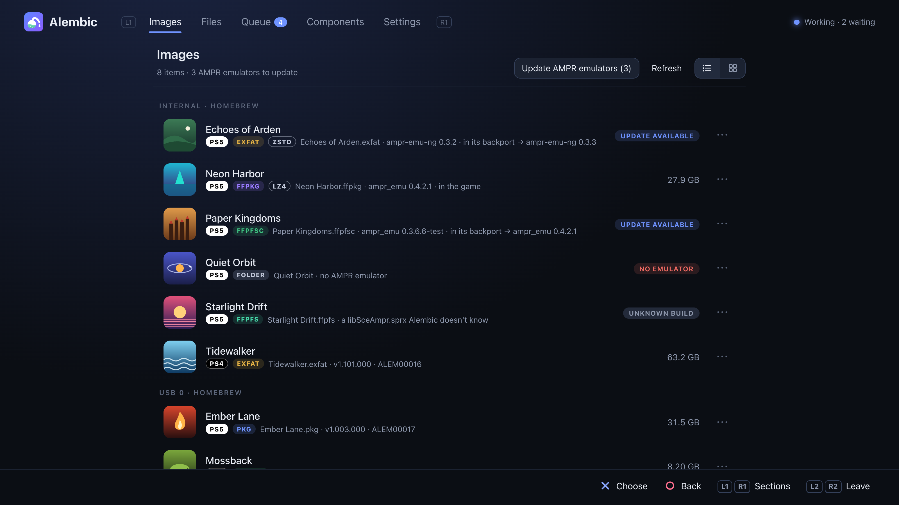

# Alembic

[English](README.md) · **Türkçe** · [Deutsch](README.de.md) · [Español](README.es.md) · [Français](README.fr.md) · [Magyar](README.hu.md) · [Русский](README.ru.md) · [日本語](README.ja.md) · [简体中文](README.zh.md)

*Bu metin [İngilizce README](README.md)'nin çevirisidir; aralarında fark varsa güncel olan İngilizcesidir.*


Alembic, PS5 ve PS4 oyunlarını homebrew yükleyicilerin kullandığı biçimler
arasında dönüştürür: paketler (PS5 debug FPKG, PS4 fake PKG), döküm
klasörleri, exFAT imajları, FFPKG (UFS2), FFPFS (PFS) ve FFPFSC (sıkıştırılmış
PFS). **Konsolda** ana ekranda bir uygulama olarak (0.3.0'dan beri) ya da web
sayfalı bir payload olarak çalışır, ikisi de kumandayla kullanılır; PC'de
(Windows, macOS, Linux) ise komut satırı aracı olarak ya da aynı motor ve
sayfayla çalışır. Ağınızdaki motorlar eşleşip birlikte çalışabilir: PC'nizde
duran bir paketi PC'nin işlemcisiyle dönüştürüp doğrudan konsolun depolama
alanına yazabilirsiniz. Bir PC'deki ya da NAS'taki oyunlar SMB, NFS, WebDAV
veya FTP üzerinden okunabilir ve oraya kaydedilebilir.

> Geliştirme sürüyor. Dönüştürdüğünüz her şeyin, sonucu konsolunuzda
> denetleyene kadar yedeğini tutun.

**Şimdiye kadar konsolda denenenler:** dökümlerden ve paketlerden yapılan
FFPFSC imajları ShadowMount+ ile çalışıyor; AMPR öykünücüsü gereken oyunlar
öykünücü eklenince açılıyor; konsol ve bir PC eşleşip birbiri için dönüştürme
yapıyor; **Kur**, bir debug paketini konsolun yükleyicisine veriyor, buna
Alembic'in bir dökümden oluşturduğu paketler de dahil (stored ya da Kraken,
oluşturulan bir debug lisansıyla, yani oyunda kilit yok); duraklatılmış bir
dönüştürme motor güncellendikten sonra devam ediyor; motor kendini bir
sürümden güncelliyor (Payload Manager ile yüklenmiş hâlde); konsol uygulaması
ShadowMount+'tan açılıyor, motoru başlatıp yeniden başlatıyor ve eşleştirilmiş
bir PC'de dönüştürme yönetiyor; bir SMB paylaşımından dönüştürülen bir paket;
zstd paketlerindeki bir oyun (160 GB'lık bir paket, bir PC motoru tarafından
5. seviyede paketlenip konsola yazılan 96 GB'lık bir exFAT'a dönüştürüldü)
ampr-emu-ng ile açılıyor. Paketlerinden dönüştürülen PS4 oyunları
ShadowMount+ 1.7beta8 ile imajlardan açılıyor (bu oyunlarda "Trophy
registration failed" gösteriyor: bir ShadowMount+ sorunu,
[#97](https://github.com/drakmor/ShadowMountPlus/issues/97)).
**Henüz denenmeyenler:** konsoldan NFS, WebDAV, SMB şifrelemesi, FTPS ve
HTTPS, ayrıca gerçek NAS cihazları ve Windows paylaşımları (hepsi bir PC'de
Samba, rclone, WsgiDAV ve pyftpdlib'e karşı denendi); Alembic paketinden
kurulan bir oyunu açmak (kurulum denendi, açmak denenmedi); Alembic'in
oluşturduğu bir PS4 paketi; PS4 güncellemeleri (yama paketleri) ve DLC. LZ4
varlık paketleri bazı oyunlarda çalışıyor, bazılarında çalışmıyor.

## Ne yapar

| Kaynak ↓ / Hedef → | Klasör | exFAT | FFPKG (UFS2) | FFPFS (PFS) | FFPFSC | Paket |
|---|:-:|:-:|:-:|:-:|:-:|:-:|
| Döküm klasörü | – | ✓ | ✓ | ✓ | ✓ | ✓ |
| exFAT | ✓ | ✓ | ✓ | ✓ | ✓ | ✓ |
| FFPKG (UFS2) | ✓ | ✓ | ✓ | ✓ | ✓ | ✓ |
| FFPFS (PFS) | ✓ | ✓ | ✓ | ✓ | ✓ | ✓ |
| FFPFSC | ✓ | ✓ | ✓ | ✓ | ✓ | ✓ |
| PS5 FPKG (debug) | ✓ | ✓ | ✓ | ✓ | ✓ | `--rebuild` |
| PS4 PKG (fake) | ✓ | ✓ | ✓ | ✓ | ✓ | `--rebuild` |

Bir oyunun dönüştüğü paket oyuna uyar: PS5 oyunu (`sce_sys/param.json`) PS5
debug FPKG'ye, PS4 oyunu (`sce_sys/param.sfo`) PS4 fake PKG'ye dönüşür. Sayfa
ve uygulama her oyunu **PS5** (beyaz) ya da **PS4** (siyah) etiketiyle
işaretler.

- **PS4 oyunları** (0.3.2'den beri): her zamanki sıfırlardan oluşan parolayla
  yapılmış fake PKG'ler (eski ve yeni paketleme araçlarından fark etmez) PS5
  paketleri gibi açılır: oyunun dosyaları ve paketteki `sce_sys` (`param.sfo`,
  simgeler, kupalar, lisans) olarak görünür ve herhangi bir imaja
  dönüştürülebilir. Bir PS4 oyununun imajları ve klasörleri, ShadowMount+'ın
  oyunu açmak için ihtiyaç duyduğu `sce_sys/param.json` dosyasını alır
  (`param.sfo`'dan,
  [PS4pkg_to_ffpfsc](https://github.com/SadykovIV/PS4pkg_to_ffpfsc)'nin
  yaptığı gibi oluşturulur); konsolda ShadowMount+ 1.7beta8 ile denendi.
  Herhangi bir biçimdeki PS4 oyunu yeniden PS4 fake PKG'ye dönüştürülebilir;
  paket [LibOrbisPkg](https://github.com/maxton/LibOrbisPkg)'nin `pkg_build`
  komutunun oluşturduğu gibi oluşturulur: oyunun lisansı korunur (yalnızca
  yoksa oluşturulur) ve PlayGo dosyaları yeniden yapılır. Bir paketin
  herhangi bir imajından yeniden oluşturulan paket bayt bayt aynıdır.
  Anahtarlar LibOrbisPkg'den gelir (Bileşenler ya da
  PC'de `--ps4-keys FILE`). AMPR öykünücüsü ve LZ4 paketleri yalnızca PS5 oyunları içindir. Bir
  oyunun hangi konsol için olduğu Title ID'sinden (`CUSA`, `PPSA`), o yoksa
  `eboot.bin` dosyasının derlendiği SDK'dan (homebrew) anlaşılır;
  `alembic game-info` ikisini de gösterir. Henüz yok: güncellemeler ve DLC,
  ayrıca sıfırlardan farklı bir parolayla yapılmış paketler.
- **Akış:** her giriş bir dosya ağacı olarak okunur ve geçici kopya olmadan
  doğrudan çıktıya yazılır; bu yüzden 100 GB'lık bir paket için yalnızca
  sonucun kapladığı alan gerekir.
- Referans araçlarla **bayt bayt aynı**: exFAT, FFPKG ve FFPFSC
  [PS5PKGTool](https://github.com/pearlxcore/PS5PKGTool) ile; FFPFS
  [MkPFS](https://github.com/PSBrew/MkPFS) (`pack folder --raw
  --no-compress`) ile; FPKG çıktısı
  [ProsperoPkgTool](https://github.com/pearlxcore/ProsperoPkgTool)
  (`img_create`, stored ya da `--compression kraken`, aynı sabit seed ile)
  ile; PS4 paketleri
  [LibOrbisPkg](https://github.com/maxton/LibOrbisPkg)'nin `pkg_build`
  komutuyla aynıdır; bir paket, `pkg_makegp4` komutunun çıkardığı projeden
  yeniden oluşturulduğunda da.
- drakmor'un [ampr_emu](https://github.com/drakmor/ampr_emu) PackedStdio
  çalışma zamanı için **LZ4 varlık paketleri** (`--lz4`): `ampr_pack.py` ile
  bayt bayt aynı; oyun profilleri
  [PS5-LZ4-Compression](https://github.com/theghostonline/PS5-LZ4-Compression)'dan.
- quer3q'nun [ampr-emu-ng](https://github.com/quer3q/ampr-emu-ng)'si için
  **zstd paketleri** (`--zstd` ya da dönüştürürken "zstd paketlerine
  paketle"): [ps5-dump-forge](https://github.com/quer3q/ps5-dump-forge)'unkiyle
  bayt bayt aynı; LZ4'ten küçük ve daha hızlı yapılır (26 GiB'lık oyun
  dosyaları bir Mac'te 33 saniyede 11,1 GiB oldu; LZ4'te 77 saniyede
  17,5 GiB). Oyuna ampr-emu-ng'nin `libSceAmpr.sprx` dosyası eklenir
  (Bileşenler'den); bu paketleri okuyamayan bir öykünücüyle değiştirilmemesi
  için ShadowMount+'ın "update emulators" ayarını kapatın. Seviyeler 1, 5
  (varsayılan) ve 19. PS5'te denendi. Paketlenmiş bir oyun Dönüştür'de LZ4 ve
  zstd paketleri arasında geçiş yapabilir ("zstd paketlerine geç"); eski
  paketler doğrudan yenilerine açılır.
- **AMPR öykünücüsü:** konsolun APR dosya okuyucusunu kullanan oyunlar,
  imajdan ya da klasörden açılabilmek için bir öykünücünün `libSceAmpr.sprx`
  dosyasına ihtiyaç duyar: drakmor'un ampr_emu'su ya da quer3q'nun
  ampr-emu-ng'si (hangisinin kullanımda olduğunu Bileşenler gösterir).
  Alembic onu dönüştürürken ya da elinizdeki bir oyuna ekler; öykünücüsü olan
  bir oyunda "AMPR öykünücüsünü ekle" ötekine geçmeyi önerir.
- **Sahte imzalama:** çalıştırılabilir dosyaları düz (imzasız) ELF olan bir
  PS5 oyunu hiç açılmaz. Dönüştürmeler bunları yol üzerinde sahte imzalı
  SELF'lere çevirir ve Dönüştür bunu önceden söyler: imaj ya da klasör için
  ampr-emu-ng'nin `make_fself.py` betiğiyle, paket için ProsperoPkgTool'un
  `img_create` komutuyla bayt bayt aynı.
- **Hızlı:** sıkıştırma ve paket çözme bütün çekirdekleri kullanır; AES,
  CRC32C ve SHA-256, işlemcide varsa onun kendi komutlarını kullanır;
  varsayılan zlib seviyesi 6'dır (PS5PKGTool ile birebir aynı çıktı için
  9).

## PS5'te

İşi motor (`alembic.elf`) yapar: onu kullandığınız şeyi kapattıktan sonra da
çalışmaya devam eden bir payload. Onu ana ekrandaki **Alembic uygulamasıyla**
ya da web sayfasıyla kullanırsınız: konsolun tarayıcısında (Medya sekmesine
eklediği kısayoldan) ya da ağınızdaki herhangi bir tarayıcıda
`http://<console-ip>:5940` adresinde. Uygulama ve sayfa aynı şeyleri gösterir
ve aynı şekilde çalışır.


**Uygulama** (`PPSA99594`, 0.3.0'dan beri) iki yoldan kurulur:

1. **ProsperoStore'dan** (en kolayı): Alembic, yerel homebrew için konsol
   mağazası olan [ProsperoStore](https://github.com/darkxex/ProsperoStore)'da
   listelenir ([Alembic'in sayfası](https://prosperostore.net/app/PPSA99594/)).
   Oradan kurun; mağaza onu güncel de tutar.
2. **İmaj ya da klasör olarak**,
   [ShadowMount+](https://github.com/drakmor/ShadowMountPlus) ile: sürümlerden
   `alembic-app-<version>.ffpkg` dosyasını `/data/homebrew/` klasörüne
   kopyalayın (ya da `alembic-app-<version>.zip` dosyasını oraya açın:
   `PPSA99594` klasörü). Simgesi, ShadowMount+'ın bir sonraki taramasından
   sonra ana ekranda görünür.

Uygulamayı açın. Yanıt veren bir motor yoksa kendi motorunu 9021 numaralı
porttaki ELF yükleyicisine gönderir (motoru olmayan bir uygulama, önce kendi
sürümünün motorunu GitHub sürümünden indirir ve `SHA256SUMS` ile denetler).

**Uygulama olmadan:**

1. `alembic-<version>.elf` dosyasını (sürümlerden) konsolunuzun ELF
   yükleyicisine gönderin.
2. Alembic'i Medya sekmesinden (ya da yukarıdaki adresten) açın.
3. **Dosyalar**'da dahili depolamada, USB'de, bir ağ sunucusunda (SMB, NFS,
   WebDAV ya da FTP) veya eşleştirilmiş bir motorun sürücüsünde bir oyun seçin
   (bir etiket PS5 ve PS4 oyunlarını ayırt eder), ardından **Dönüştür**,
   **Kur** (paketler), **Kopyala** ya da **Taşı**'yı seçin. Bir PS5 oyununu
   pakete dönüştürürken, iş bitince paket konsolun yükleyicisine verilebilir
   (**Bitince kur**); **Paketi sakla** açık değilse yükleyici paketi okuduktan
   sonra paket silinir, yani o zamana kadar paket için yer gerekir.
4. İşler **Kuyruk**'ta teker teker çalışır: duraklatın, sürdürün (uzun işler
   son kayıt noktasından devam eder), sıralarını değiştirin, iptal edin. Bir
   iş bitince bildirim alırsınız.


Sayfada ayrıca:

- **Önce kumanda:** yön tuşları gezinir, ✕ seçer, ○ geri gider, □ bir
  dosyanın seçeneklerini açar, L1/R1 bölümler arasında geçer, L2/R2 listelerde
  sayfa sayfa ilerler. Çıkmak için L2 + R2'ye birlikte, ardından ○'a basın
  (bir sayfa konsolun tarayıcısını kendisi kapatamaz). Ayarlar'da bir kumanda
  testi var. PC'de: ok tuşları, Enter, Esc, S, Q/E ve Page Up/Down.
- **Konumlar:** herhangi bir klasörü Seçenekler'inden Konumlar'a ekleyin; yan
  çubukta, Kayıt yeri'nde ve eşleştirilmiş motorlarda görünürler.
- **Yeniden adlandır** (0.4.1'den beri): bir oyunu yeniden adlandırırken,
  mevcut adın yanında oyunun başlığından, Title ID'sinden, sürümünden ve
  biçiminden yapılmış adlar önerilir (`Title [ABCD12345].ffpfsc`, …); seçilen
  ad yine düzenlenebilir. Biçimleri **Ayarlar → Yeniden adlandırma
  biçimleri**'nden istediğiniz gibi değiştirebilirsiniz: `{title}` `{titleid}`
  `{contentid}` `{version}` `{format}` `{platform}` `{name}` (ya da
  `[titleid]`) alanları, `{title:upper}`, `{title:20}` ya da
  `{version:short}` gibi değiştiriciler, bir değer yoksa dışarıda bırakılan
  kısım için `<…>`, ve her biçim için boşluklara (koru, kaldır, `_`, `.`, `-`)
  ve harflere (olduğu gibi, BÜYÜK HARF, küçük harf) ne yapılacağı.
  ShadowMount+'ın bağlayamayacağı kadar uzun bir ad (`.ffpfsc` öncesinde 58
  bayt; `.exfat`, `.ffpkg` ve `.ffpfs` öncesinde 63 bayt) işaretlenir ve
  ardından kısaltılmış bir ad önerilir; elle yazılan uzun bir ad için onay
  istenir. Gizli bir ad (`.name`) gizli kalır.
- **Birden çok dosya birden** (0.4.2'den beri): bir dosyada □ → **Seç…**,
  ardından ✕ satırları işaretler, □ işaretlilerin işlemlerini açar, ○ seçimi
  bitirir. Dönüştür (oyun başına bir iş; zaten hedef biçimde olan oyun dışarıda
  kalır), Kur, AMPR öykünücüsünü ekle, ShadowMount+'tan gizle ya da
  ShadowMount+'a yeniden göster, Bir biçimle yeniden adlandır (önce eski → yeni
  gösterilir), Başka bir motora gönder, Kopyala, Taşı ve Sil; her işlem
  yalnızca uygulanabildiği dosyaları alır.
- **Paketler ve gizleme** (0.5.0'dan beri): varlık paketlerindeki oyunların
  biçiminin yanında LZ4 ya da ZSTD etiketi bulunur. **Gizle** / **Göster**
  (adı `.name` yapmak ve geri almak) paketler dahil her dosya ve klasörde
  çalışır; imajlarda ShadowMount+'tan gizle / ShadowMount+'a yeniden göster de
  kalır, bunlar ayrıca yeniden tarama başlatır.
- **Ağ sunucuları** (Ayarlar, 0.3.3'ten beri): bir PC'deki ya da NAS'taki
  oyunlar önce konsola kopyalanmadan dönüştürülebilir; şunlar üzerinden:
  - **SMB** (Windows paylaşılan klasörleri, çoğu NAS cihazı): Windows 11'in
    istediği gibi imzalamalı SMB 2 ve 3, sunucu ya da paylaşım isterse SMB 3
    şifrelemesi (AES-128-GCM ya da -CCM); kullanıcı adı ve parola ya da
    misafir girişi. Sunucunun bütün paylaşımlarını görmek için paylaşımı boş
    bırakın.
  - **NFS** (NAS ve Linux dışa aktarımları): NFSv3; parola yerine
    kullanılacak uid:gid ile. Hepsini görmek için dışa aktarımı boş bırakın.
  - **WebDAV** (NAS, Nextcloud, rclone): HTTP ya da HTTPS, Basic ya da Digest
    girişi.
  - **FTP**: FTP ya da FTPS (açık ya da 990 numaralı portta örtük).

  Sunucu yalnızca dosyaları saklar: motor oyunu ağ üzerinden okur ve
  dönüştürmeyi kendisi yapar. exFAT, FFPKG, FFPFS ve klasör çıktıları yeniden
  sunucuya kaydedilebilir; FFPFSC ve PKG çıktıları önce konsola gider. **TLS
  ile şifrele** açıkken FTP ve WebDAV, TLS 1.2 ya da 1.3 (mbedTLS) üzerinden
  gider. Ev sunucularının sertifikaları çoğunlukla kendinden imzalıdır; bu
  yüzden Alembic, SSH'nin yaptığı gibi bir sunucunun sertifikasına ilk
  kullanımda güvenir: ilk bağlantıda sunucudakiyle karşılaştırmanız için
  SHA-256 parmak izini gösterir ve sorar; sonraki bağlantılar aynısını
  göstermelidir, değişmiş bir sertifika uyarıyla reddedilir. İşi bir PC'nin
  yapmasını istiyorsanız, onun yerine o PC'de Alembic'in motorunu çalıştırın
  (bkz. [Motorlar arası çalışma](#motorlar-arası-çalışma)).
- **Bu bilgisayardan:** bir PC'nin tarayıcısında açılan sayfa, o PC'deki bir
  dosyayı konsolun dönüştürmesi için paylaşabilir.
- **ShadowMount+:** yeni imajlar yeniden başlatma gerekmeden algılatılabilir,
  kaynaklar da dönüştürüldükten sonra ondan gizlenebilir.
- **İmajlar:** ShadowMount+'ın taradığı klasörlerdeki tüm imajlar, oyun
  klasörleri ve paketler (gizliler de), klasöre göre gruplanmış hâlde, oyun
  simgelerinden bir ızgara ya da liste olarak (üstündeki düğmeyle seçilir;
  Dosyalar'da da aynı düğme var ve liste olarak açılır). Klasörlere taşıma ve
  kopyalama dışında Dosyalar'ın sunduğu her şey burada: Dönüştür, Kur,
  Yeniden adlandır, AMPR öykünücüsü, ShadowMount+'tan gizle, Başka bir motora
  gönder, Sil, birden çoğu için Seç ve bulunduğu klasörü açan **Dosyalar'da
  göster**. APR kullanan oyunlarda her birinin çalıştığı AMPR öykünücüsünü
  (oyunun içinde ya da backport klasöründe) ve daha yeni bir derlemenin çıkıp
  çıkmadığını gösterir; **AMPR öykünücülerini güncelle**, her oyunun kendi
  öykünücüsünün en yeni derlemesini, öykünücüsü olmayan oyunlaraysa
  kullanımdakini koyar. İki öykünücünün de tüm resmî derlemeleri, GitHub'ın
  yayımladığı SHA-256 ile tanınır.
  Uygulamaların `/data/downloads` klasörüne (altındaki herhangi bir
  klasöre) indirdiği paketler de listelenir; bilgisayarda, sistemin
  İndirilenler klasöründekiler.
  Eşleştirilmiş motorların imajları, her motor için ayrı bir bölümde
  ardından gelir (Gönder, Dönüştür ve diğerleri Dosyalar'daki gibi çalışır);
  AMPR öykünücüleri yalnızca bir PS5'te, kendi oyunları için gösterilir ve
  güncellenir.
  Bir PS5'te sayfa ve uygulama İmajlar ile açılır; bilgisayarda Dosyalar ile.

  
- **Bileşenler:** Alembic'in ihtiyaç duyduğu ama kendisiyle gelmeyen üçüncü
  taraf dosyalar (AMPR öykünücüleri ampr_emu ve ampr-emu-ng,
  ProsperoPkgTool'un FPKG anahtar dosyaları, LibOrbisPkg'nin lisans ve PS4
  paket anahtarları) istek üzerine resmî kaynaklarından indirilir ve yalnızca
  SHA-256'ları eşleşirse saklanır. İki AMPR öykünücüsü kendi projelerinin son
  sürümlerini izler: motor başlarken (ya da **Güncellemeleri denetle** ile)
  GitHub'a bakar ve **Kendiliğinden güncelle** açıksa (varsayılan) daha yeni
  bir derlemeyi indirir; GitHub'ın ve sürümün `SHA256SUMS` dosyasının onun için
  verdiği SHA-256 ile denetler. Öykünücülerden biri **kullanımda**dır:
  dönüştürmelerin ve "AMPR öykünücüsünü ekle"nin oyuna koyduğu odur. Bir oyun
  aldığı derlemeyi korur; o oyunda "AMPR öykünücüsünü ekle", onu kullanımdaki
  öykünücüyle değiştirmeyi önerir. ampr-emu-ng kendi zstd paketlerini de okur.
  **Çevrimdışı:** bunları bir PC'de aşağıdaki bağlantılardan indirin
  (öykünücüler için Alembic'in en son denendiği derlemeler; aynı projenin daha
  sonraki herhangi bir sürümü de çalışır) ve konsola tam olarak bu adlarla
  kopyalayın; motor onları yeniden başlatma gerekmeden algılar:

  | Bileşen | İndir | Konumu | SHA-256 |
  |---|---|---|---|
  | AMPR öykünücüsü (ampr_emu 0.4.2.1) | [libSceAmpr.sprx](https://github.com/drakmor/ampr_emu/releases/download/0.4.2.1/libSceAmpr.sprx) | `/data/alembic/runtime/libSceAmpr.sprx` | `69e6c4d5e4f5fb83c9e01815db5861c4c75734acbf4595cafa50d4c218116d1a` |
  | AMPR öykünücüsü (ampr-emu-ng 0.2.0) | [libSceAmpr.sprx](https://github.com/quer3q/ampr-emu-ng/releases/download/v0.2.0/libSceAmpr.sprx) | `/data/alembic/runtime/ampr-emu-ng/libSceAmpr.sprx` | `7acb2173d9691b5dfb94ea4007660920b7250111c5fd7a86c6eb91b763ad3d76` |
  | FPKG anahtar dosyaları | [passcode.bin](https://raw.githubusercontent.com/pearlxcore/ProsperoPkgTool/f2c91cd7a5d8440b7b9ae5e0b1154334093bf613/ProsperoPkgTool/Keys/passcode.bin) | `/data/alembic/keys/passcode.bin` | `81e8283d582f522d8da34565ecd6ab39a38b3d3c0cacef078df97d2b285ec24e` |
  | | [mount_image.bin](https://raw.githubusercontent.com/pearlxcore/ProsperoPkgTool/f2c91cd7a5d8440b7b9ae5e0b1154334093bf613/ProsperoPkgTool/Keys/mount_image.bin) | `/data/alembic/keys/mount_image.bin` | `4510462812321cea26b4c0155e363955b16e31b89252b92510accad02eca5cd0` |
  | | [metadata_modulus.bin](https://raw.githubusercontent.com/pearlxcore/ProsperoPkgTool/f2c91cd7a5d8440b7b9ae5e0b1154334093bf613/ProsperoPkgTool/Keys/metadata_modulus.bin) | `/data/alembic/keys/metadata_modulus.bin` | `4a585ee47fea88d6b121d5e8afc9829438a27ee325cebec56a2ff537129a37c5` |
  | Lisans ve PS4 paket anahtarları | [Keys.cs](https://raw.githubusercontent.com/maxton/LibOrbisPkg/643477263b2644e0803e0f58b8726ea4e3f3b7d4/LibOrbisPkg/Util/Keys.cs) | `/data/alembic/keys/ps4/Keys.cs` | `48b44dd03e653a5c0991b0a2975477802ea2639c4e6ea3270b2ff20a1856f8a7` |

  Anahtar dosyaları sabitlenmiş olanlar (aynı SHA-256) olmalıdır, yoksa paket
  çıktısı onları reddeder: bunlar sabit değerlerdir, hiçbir şeyi izlemezler.
  Elle kopyalanan bir öykünücü derlemesi yine çalışır ama motor kendisi bir
  derleme indirene kadar Bileşenler'de "değişmiş" olarak görünür.
- **Motor** (Ayarlar): **Motoru yeniden başlat** aynı sürümü ELF yükleyicisi
  üzerinden yeniden başlatır; motor durduğunda uygulama ayrıca **Motoru
  başlat**'ı sunar.
- **Güncellemeler** (0.2.3'ten beri): motor başlarken GitHub'da daha yeni bir
  sürüm arar ve varsa söyler; **Ayarlar → Güncellemeler** sürüm notlarını
  gösterir. **Güncelle** payload'u indirir, sürümün `SHA256SUMS` dosyasıyla ve
  içine yazılmış sürümle denetler, ve yükleyicinizin onu başlattığı kopyaların
  yerine koyar: Payload Manager'ınkiler (yeni sürümün adıyla yeniden
  adlandırılır, o payload'un `meta.json` dosyasındaki ad da düzeltilir) ve
  `ps5_autoloader` klasörleri (aynı adla); **Sürücüleri ara** başka yerlerdeki
  kopyaları bulur. Ardından yeni motor ELF yükleyicisi (port 9021) üzerinden
  başlar ve işi devralır; ilerlemesini koruyabilen çalışan bir iş devam eder.
  Daha yeni bir `alembic.elf` dosyasını elle göndermek de çalışan motorun
  yerini alır. 0.3.0'dan beri aynı güncelleme, sürümdeki farklıysa
  uygulamanın `.ffpkg` dosyasını da değiştirir; uygulama açıkken bu, uygulama
  kapanana kadar bekler (ProsperoStore'dan kurulan uygulamayı mağaza
  günceller). Motorundan eski bir uygulama bunu söyler ve **Uygulamayı
  güncelle**'yi sunar.
- **Diğer motorlar:** kapatılmış eşleşmiş bir motor kaybolmak yerine
  çevrimdışı olarak listede kalır.
- **Meşgul sürücüler:** çalışan bir işin meşgul tuttuğu bir sürücüden oyun
  başlıkları ve simgeleri yüklenirken uygulama kuyruğu güncel tutmaya devam
  eder.
- Diller: English, Türkçe, Deutsch, Español, Français, Magyar, Русский, 日本語, 简体中文
  (Magyar çevirisi isty1974'ten).

Durum (kuyruk, ayarlar, indirilen bileşenler) `/data/alembic` içinde tutulur.

## Motorlar arası çalışma

Konsoldaki payload'un yanında bir PC'de de `alembic-engine` çalıştırın.
Eşleştikten sonra her motor ötekinin dosyalarını okuyup yazabilir ve ona iş
verebilir.

1. **Ayarlar → Diğer motorlar**'da her ikisinde de **Bu ağdaki motorları
   bul**'u açın (varsayılan olarak kapalı) ya da birini adresiyle ekleyin.
2. Diğer motorun yanındaki **Eşleştir**'e basın. Altı haneli bir kod gösterir
   (PS5'te bildirim olarak, PC'de kendi penceresinde); onu yazın. Eşleşmiş
   motorlar her isteği üzerinde anlaştıkları anahtarla imzalar.
3. Diğer motorun sürücüleri ve Konumları **Dosyalar**'da *Diğer motorlar*
   altında, hem giriş hem de kayıt yeri olarak görünür.
4. **Dönüştür**'de **Dönüştüren**, işi yapacak motoru seçer (şu anda çevrimiçi
   olanlardan). Kaynak, dönüştüren motor ve çıktı ayrı ayrı motorlarda
   olabilir; veri aralarında akar, önceden kopya yapılmaz.

Bir iş, dosyalarını kullandığı her motorun kuyruğunda görünür ("Salondaki PC
üzerinde") ve herhangi birinden duraklatılabilir, sürdürülebilir, iptal
edilebilir ya da geçmişten temizlenebilir. Bir iş çıktıyı denetledikten sonra
kaynağını sildiğinde, motorlar dosyaları geri göndermek yerine SHA-256
özetlerini karşılaştırır. Dosyalar dönüştürülmeden de motorlar arasında
gönderilebilir (Seçenekler → Başka bir motora gönder).


Farklı Alembic sürümlerindeki motorlar, birbirleriyle aynı şekilde
konuştukları sürece birlikte çalışır; bu bir sürümde değişirse Ayarlar hangi
motorun güncellenmesi gerektiğini gösterir ve güncellenene kadar birbirlerini
reddederler.

Sayfanın kendisinde parola yoktur: ağınızdaki herkes açabilir. Bir PC
motorunu yalnızca o bilgisayara açık tutmak için `--listen 127.0.0.1` ile
başlatın; o zaman diğer motorlar ona ulaşamaz.

## PC'de

Her sürümde her sistem için bir paket vardır: `alembic-<version>-linux-x64.tar.gz`,
`-macos-arm64.tar.gz` (Apple silicon) ve `-windows-x64.zip`; her birinde
`alembic` ve `alembic-engine` bulunur. macOS derlemeleri imzalı değildir:
tarayıcıdan indirdikten sonra klasörlerinde bir kez `xattr -d
com.apple.quarantine alembic alembic-engine` çalıştırın, yoksa macOS onları
başlatmayı reddeder.

```sh
alembic convert game.pkg game.ffpfsc              # format from the extension (PS5 or PS4 package)
alembic convert ps4game.exfat game.pkg --ps4-keys Keys.cs   # a PS4 game back to a PS4 fake PKG
alembic convert game.exfat game/ --to folder      # unpack to a folder
alembic convert game/ game.exfat --lz4 --lz4-runtime libSceAmpr.sprx
alembic convert game/ game.exfat --zstd --zstd-runtime libSceAmpr.sprx   # ampr-emu-ng's
alembic ls game.ffpkg                             # list the files of any input
alembic same game.pkg game.ffpfsc                 # compare two inputs file by file
alembic game-info game.exfat                      # title ID, SDK and PS4 or PS5
alembic --help                                    # every command and option
```

`alembic-engine`, payload ile aynı motordur ve aynı web sayfasına sahiptir
(`http://localhost:5940`); PC'de dönüştürmek ya da konsolla eşleşmek içindir.
`--root DIR` (birden çok kez verilebilir) paylaştığı klasörleri seçer
(varsayılan olarak ev klasörünüz); `alembic-engine --help` diğer seçenekleri
listeler. Ayarlar → Güncellemeler daha yeni bir sürüm çıktığında bunu söyler;
PC'de onu indirip dosyaları kendiniz değiştirin.

## Derleme

Gerekenler: CMake 3.20+, bir C++20 derleyicisi, zlib (PS5 için kendisiyle
gelir) ve motorun web sayfası için npm ile Node.js 20+ (`src/engine/web`,
esbuild ile paketlenen Preact ve TypeScript; ilk derleme orada `npm ci`
çalıştırır).

```sh
cmake -S . -B build -DCMAKE_BUILD_TYPE=Release
cmake --build build -j
./build/alembic_tests
```

Windows sürümü (`alembic.exe`, `alembic-engine.exe`) macOS ya da Linux'ta
[llvm-mingw](https://github.com/mstorsjo/llvm-mingw) ile çapraz derlenir;
çalıştırılabilir dosyalar statik bağlıdır ve Windows 10 ve sonrasında olduğu
gibi çalışır. `tools/windows/smoke.sh` onları Windows'ta (Git Bash) denetler.

```sh
cmake -S . -B build-win -DCMAKE_BUILD_TYPE=Release -DCMAKE_TOOLCHAIN_FILE=cmake/mingw-w64-x86_64.cmake \
      -DLLVM_MINGW=/path/to/llvm-mingw
cmake --build build-win -j
```

PS5 payload'u için LLVM 18 ve
[ps5-payload-dev/sdk](https://github.com/ps5-payload-dev/sdk) v0.44 gerekir:

```sh
# macOS: brew install llvm@18 · Debian/Ubuntu: apt install clang-18 lld-18 llvm-18
export PS5_PAYLOAD_SDK=/path/to/ps5-payload-sdk   # default: .refs/ps5-payload-sdk
tools/ps5/build.sh                                # → build-ps5/alembic.elf
```

GitHub Actions, belgelerden fazlasını değiştiren her push'ta her şeyi
derler ve sınar (bkz. [.github/workflows/build.yml](.github/workflows/build.yml)).
Her çalıştırmada payload ayrı bir indirme olarak, `alembic-<version>.elf`,
bir de paket hâlinde, `alembic-<version>.zip`, bulunur: payload `ps5/`
içinde, `alembic` ve `alembic-engine` `linux-x64/`, `macos-arm64/` ve
`windows-x64/` (`.exe`) içinde; README ve lisans dosyalarıyla birlikte. Sürüm
etikettir (`v0.1.0`), etiket yoksa dal ve commit (`main-a2fab12`). Bir `v*`
etiketi payload'u, paketi, her PC sistemi için bir paketi, konsol
uygulamasını (`.ffpkg` ve `.zip`) ve `SHA256SUMS` dosyasını bir sürüm olarak
yayımlar. 0.3.1'den beri her sürüm dosyası bir derleme onayı (build
attestation) taşır: `gh attestation verify <file> --repo fthdgn-gh/Alembic`,
dosyayı bu deponun iş akışının derlediğini ve hangi commit'ten derlendiğini
gösterir.

### Web sayfası

Motorun sayfası `src/engine/web` içindedir: TypeScript ile yazılmış Preact
bileşenleri (`src/pages/` içinde her bölüm için bir klasör var; geri kalanını
`src/main.tsx` eşler), PS5'in eski tarayıcısı için motorun gömdüğü tek bir
HTML dosyasında paketlenir. Üzerinde çalışmak için bir motor çalıştırın ve
sayfanın her değişiklikte yeniden derlenmesini sağlayın:

```sh
build/alembic-engine --listen 127.0.0.1 &   # its API, on port 5940
cd src/engine/web
node build.mjs --serve                      # the page at http://127.0.0.1:5950
npx tsc --noEmit                            # type check (CI runs it too)
python3 ../../../tools/i18n_keys.py --check # every text translated
```

`tools/screenshots/shoot.sh`, README'nin ekran görüntülerini uydurma
oyunlarla dolu yedek bir motora karşı oluşturur.

### Referans araçlarla karşılaştırma

`tools/` içindeki betikler Alembic'in çıktısını izlediği araçlarla bayt bayt
karşılaştırır. Referans projelerin `.refs/` içinde (git tarafından yok
sayılır) çekilmiş olması gerekir; bunun nasıl yeniden oluşturulacağını
[docs/NOTES.md](docs/NOTES.md) anlatır.

```sh
tools/oracle/compare.sh        # exFAT, FFPKG, FFPFS, FFPFSC vs PS5PKGTool and MkPFS
tools/pkg-oracle/compare.sh    # FPKG reading and writing vs ProsperoPkgTool / LibProsperoPKG
tools/pkg-oracle/write_samples.sh  # FPKG writing vs ProsperoPkgTool on your own packages
tools/lz4-oracle/compare.sh    # LZ4 packs vs ampr_emu's ampr_pack.py
tools/zstd-oracle/compare.sh   # zstd packs vs ps5-dump-forge (builds it with cargo)
tools/fself-oracle/compare.sh  # fake-signed SELFs vs ampr-emu-ng's make_fself.py
tools/ps4-oracle/compare.sh    # PS4 packages vs LibOrbisPkg's pkg_build, pkg_extract and pkg_validate
```

## Alembic'te neler yok

- Bu depoda ya da ikili dosyalarında Oodle, `libScePubTools`, kapalı kaynaklı
  paket kütüphaneleri veya konsol anahtarları yoktur. FPKG çıktısı
  ProsperoPkgTool'un yayımlanmış anahtar dosyalarını kullanır; PS4 paket
  çıktısı LibOrbisPkg'nin `Keys.cs` dosyasını kullanır (bu dosyada debug
  lisans anahtarı da vardır; yalnızca lisansı olmayan bir oyuna, PS5 ya da
  PS4, lisans oluşturmak için kullanılır). Motor ikisini de istek üzerine
  indirir.
- Üçüncü taraf ikili dosya yoktur: AMPR öykünücülerinin `libSceAmpr.sprx`
  dosyası her projenin resmî GitHub sürümünden indirilir ve onunla birlikte
  yayımlanan SHA-256 ile denetlenir.

## Teşekkürler

Alembic, PS5 homebrew topluluğunun emeği üzerine kurulu. Teşekkürler:

- **pearlxcore**: [PS5PKGTool](https://github.com/pearlxcore/PS5PKGTool)
  (exFAT, PFSC ve FFPFSC; Alembic'in bayt bayt eşleştiği referans) ve
  [ProsperoPkgTool](https://github.com/pearlxcore/ProsperoPkgTool) (debug
  paketlerini okuma ve yazma, ve anahtar dosyaları) için.
- **SadykovIV**: [PS4pkg_to_ffpfsc](https://github.com/SadykovIV/PS4pkg_to_ffpfsc)
  (bir PS4 oyununun imajının ShadowMount+ için nasıl görünmesi gerektiği,
  `param.json` dosyası) için.
- **SvenGDK**: [UFS2Tool](https://github.com/SvenGDK/UFS2Tool) (FFPKG okuyucu
  ve yazıcı) ve [LibProsperoPKG](https://github.com/SvenGDK/LibProsperoPKG)
  (deneme paketleri) için.
- **drakmor**: [ampr_emu](https://github.com/drakmor/ampr_emu) (AMPR dizini,
  LZ4 varlık paketleri ve onları okuyan çalışma zamanı) ve
  [ShadowMountPlus](https://github.com/drakmor/ShadowMountPlus) (Alembic
  imajlarının yapıldığı yükleyici ve HTTPS indirme kodu) için.
- **quer3q**: [ampr-emu-ng](https://github.com/quer3q/ampr-emu-ng) (ikinci
  AMPR öykünücüsü ve zstd paketleri) ve
  [ps5-dump-forge](https://github.com/quer3q/ps5-dump-forge) (Alembic'in
  izlediği ve karşılaştırıldığı zstd paket yazıcısı) için.
- **PSBrew**: [MkPFS](https://github.com/PSBrew/MkPFS) (PFS yazıcısı) için.
- **maxton**: [LibOrbisPkg](https://github.com/maxton/LibOrbisPkg) (PS4
  paketleri: Alembic'in izlediği yazıcı, anahtarları ve Alembic'in
  karşılaştırıldığı araç) için.
- **theghostonline**:
  [PS5-LZ4-Compression](https://github.com/theghostonline/PS5-LZ4-Compression)
  (LZ4 paket profilleri ve motor-ile-sayfa fikri) için.
- **danthespal**: [MkPFS.CSharp](https://github.com/danthespal/MkPFS.CSharp)
  ile paylaşılan LZ4 oyun profilleri için.
- **ps5-payload-dev**: [PS5 payload SDK](https://github.com/ps5-payload-dev/sdk),
  [shsrv](https://github.com/ps5-payload-dev/shsrv) (paket kurulumları) ve
  [websrv](https://github.com/ps5-payload-dev/websrv) (Medya sekmesi
  kısayolu) için; ayrıca
  [owendswang/ps5-web-file-manager](https://github.com/owendswang/ps5-web-file-manager)
  ve [itsPLK/ps5-payload-manager](https://github.com/itsPLK/ps5-payload-manager).
- **blackbearreloaded**: sayfanın izlediği tasarım olan
  [ps5-homebrew-ui](https://github.com/blackbearreloaded/ps5-homebrew-ui) için.
- Microsoft'un [açık belirtimleri](https://learn.microsoft.com/openspecs/)
  (SMB2/3, NTLM, SPNEGO, DCE/RPC ve paylaşım listesi) ve ağ istemcilerinin
  dayandığı NFSv3, ONC RPC ve WebDAV için IETF RFC'leri.
- Motorla birlikte gelen [zlib](https://zlib.net),
  [LZ4](https://github.com/lz4/lz4) ve
  [Zstandard](https://github.com/facebook/zstd); sayfasına paketlenen
  [Preact](https://github.com/preactjs/preact) ve
  [signals](https://github.com/preactjs/signals).

Ekran görüntülerindeki oyunlar, motorlar ve adresler uydurmadır
(`tools/screenshots/shoot.sh` onları yedek bir motora karşı oluşturur).

## Lisans

GPL-3.0-or-later ([LICENSE](LICENSE)). Alembic birçok GPL, LGPL, MIT ve BSD
projesinden kod aktarır; [THIRD_PARTY_NOTICES.md](THIRD_PARTY_NOTICES.md)
her birini, ondan neyin alındığını ve lisansını listeler.
